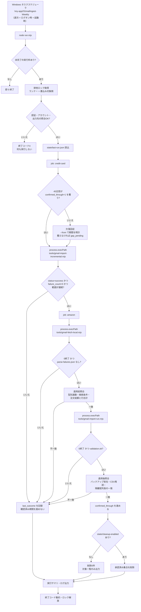

# 設計書：Gmail 取り込みを非AIの単一ランナー（gmail-ingest）へ一本化する（Phase 1）

Google Workspace API の規約変更により、2027-02-01 から AI エージェントが Workspace データへアクセスする場合は REST API 直接利用ではなく MCP の利用が求められる。現在 `amazon-tracker` / `credit-card-tracker` の Gmail 取り込みは Codex Automation（AI 実行基盤）から起動されているため、取得経路から AI を実際に外し、Windows タスクスケジューラから実行される単一の非AIランナーへ移行する。

- **作成日**: 2026-11-25
- **対象アプリ**: `gmail-ingest`（新規）/ `amazon-tracker` / `credit-card-tracker` / 親リポ共通ルール
- **種別**: 修正設計書（新規 CLI `gmail-ingest` の機能設計書を兼ねる）
- **対象バージョン**: `gmail-ingest` v0.1.0（新規）/ `amazon-tracker` v0.2.0（予定）/ `credit-card-tracker` v0.1.2（予定）
- **前提コミット**: `amazon-tracker` `f273aa3` / `credit-card-tracker` `573607c` / 親リポ `1272450`
- **ステータス**: ドラフト（レビュー指摘反映版・再レビュー待ち）— 2026-11-25 の設計レビューで **着手不可（No-Go）** 判定（P1 8 件 / P2 5 件 / 外部仕様の訂正 1 件）。同日その全件を本文へ反映した。着手可否の再判定はレビュー側が行う
- **関連**:
  - レビュー: [Gmail取り込み非AI一本化 Phase 1 設計レビュー](設計レビュー_Gmail取り込み非AI一本化_Phase1_2026-11-25.md)（判定 着手不可。指摘の反映状況は §変更履歴 2026-11-25 の 3 行目を参照）
  - 後続: Phase 2 設計書（Gmail REST 呼び出しコアの共通化）— 未起票
  - `credit-card-tracker/docs/実装設計書_Gmail週次Automation効率化_2026-07-10.md`（別リポジトリのため §4.1 によりリンクせず名称で参照。本設計は同設計の「Automation 入口＝`npm run gmail:import-incremental`」を温存し、その起動元だけを差し替える）
  - `amazon-tracker/gmail-import-rules.md`（別リポジトリ。取り込みルールの正本。本設計により §Codex Automation 運用と §Gmail API 認証の一部を改訂する）
  - 根拠とした外部資料: Google Cloud Platform 通知メール「[Pricing Update] Changes to Google Workspace API usage limits starting Feb 2027 and new AI policies」（受信 2026-11-25、対象プロジェクト `credit-card-tracker-496602`）および同日付の影響調査報告書。要点は §1.1 / §1.2 に書き写す（§4.1 に従い外部ファイルへのリンクは置かない）

---

## 1. 目的・背景

### 1.1 Google 通知の要点（本設計で前提とする範囲）

| 日付 | 内容 |
|---|---|
| 2026-11-24 | Workspace API に Standard / Scaled の 2 階層を導入。以後の上限引き上げ申請は Scaled が必要 |
| 2027-02-01 | **AI エージェント等に対する MCP 利用要件の技術的適用開始**。この日に始まるのは MCP 要件のみ |
| 2027-04-01 | **全プロジェクトに対する Standard 上限の適用開始**と、Scaled 対象利用への課金開始。未対応プロジェクトは Standard 上限へ移行（追加料金なし） |

> **訂正（2026-11-25・レビュー指摘）**: 起票時は 2027-02-01 に「利用制限の適用開始」を併記していたが、公開ロードマップ（Usage tiers and quotas for Google Workspace APIs and MCP servers、2026-11-25 確認）は **2027-02-01 の AI 向け MCP 要件と、2027-04-01 の全プロジェクトへの Standard 上限適用・課金開始を区別**している。上の表はこれに合わせて訂正した。本設計の期限設定（2027-01-31 までに非AI化）は MCP 要件の日付に依拠するため変わらない。
>
> また、条件を満たす組織内利用には、一部 REST API のプロジェクト上限について例外申請経路がある。**本件の例外適格性と実使用量はいずれも未確認**で、上限内かどうかは §8.4 の実測で判断する（§10.2）。

- Standard は無料で、公開された利用上限が適用される。上限内であれば対応不要。
- **AI エージェント等が Workspace データへアクセスする場合は、REST API 直接利用ではなく MCP を使うことが求められる。**
- 通常の非AIプログラムによる REST API 利用が一律禁止されたわけではない。
- AI によるスクレイピング、および取得データの長期保存に関する制限が Workspace AI Tools Addendum で導入される。

AI 実行基盤が REST API を呼び出す既存スクリプトを「起動する」構成が適用対象になるかについて、Google から個別の確定回答は得ていない。本設計は、適用されても問題にならない側へ寄せる（AI を実行経路から実際に外す）という方針を取る。

#### 1.1.1 Workspace AI Tools Addendum の原文確認（2026-11-25 追記）

公開ページ（`workspace.google.com/terms/ai-tools/`、Last modified: November 24, 2026 / 効力発生 2027-02-01）と利用階層ページ（`developers.google.com/workspace/guides/quota-usage-tiers`、Last updated 2026-11-24）を読み、本設計に関係する条項を確認した。要点のみ書き写す（§4.1 によりリンクは置かない）。

| 論点 | 原文確認の結果 |
|---|---|
| MCP 要件の適用対象 | Addendum 項目 1 の MCP 要件は、`GWS Access Tool` が **AI Agent / AI Harness / AI model またはそれを使うサービスである場合、またはそれらに駆動される場合**に限られる。**cron やタスクスケジューラから起動される非AIスクリプトには MCP 要件が直接かからない。** 本設計の方針（AI を実行経路から外す）はこの条項に対して有効 |
| 制限条項の適用対象 | 一方で禁止事項 2(a)–(g) は `GWS Access Tool` 全般にかかり、その定義は `any AI Agent, AI Harness, software, application, ...` と広い。**非AIスクリプトも 2(a)–(g) の対象と読める**（Addendum に「非AIスクリプトも対象」と明記した文言はないため、これは解釈） |
| 30 日の保存上限 | 2(b) に `Store any Google Technical Information for more than 30 days` とある。**30 日上限は `Google Technical Information` に対するもの**で、Addendum は `Google Technical Information does not include any user data.` と明記している。定義は vector embeddings / memory indexes / user profiles / organizational graphs / findings / failure patterns 等の、アクセスや相互作用から派生した情報 |
| user data の保存 | 2(a) は user data を**期間ではなく目的で制限**する（`active, user-authorized tasks` を満たす目的以外での処理の禁止）。**数値の保存期間は定められていない** |
| 権限取り消し後 | 2(d) は、`GWS Access Tool` を切断またはアクセスを取り消した後に user data および `Google Technical Information` を**保持することを禁止**している。削除期限や手続きの具体的記述はない |
| スクレイピング | 2(e) は `user-authorized task` に必要な範囲を超えた scraping / systematic probing を禁止 |
| Standard 上限 | 利用階層ページには、GA の Google Workspace MCP servers について `capped at 5,000 requests per day, per project, per product`（加えて分あたり上限あり）と記載。**REST の Gmail API の 1 日／1 分あたりの具体値は同ページには記載されていない**。また MCP ツールは複数の API 呼び出しを行う場合に複数リクエストとして数えられる旨の記載がある |

**本設計への帰結:**

1. **`orders.csv` の購入履歴と SQLite の取引明細は `user data` であり、`Google Technical Information` ではない。したがって 30 日の保存上限は適用されない。** 影響調査報告書が留保していた「一律 30 日の保存上限が課されるとは判断しない」は、原文確認により裏付けられた。家計簿・購入履歴管理という利用目的が 2(a) の `active, user-authorized tasks` に該当する限り、保存期間の数値制約は生じない。
2. **2(d) により、OAuth のアクセスを取り消した場合は Gmail 由来の user data を保持できない。** 権限取り消し時の手順整備が必須となる（§4.6-3）。Amazon 公式 CSV エクスポート由来のデータは Workspace API 経由で取得していないため 2(d) の対象外であり、両者の区別が必要になる（§10-10）。
3. 中間ファイル（メール本文 JSONL・候補 JSON）は user data だが、取り込み完了後は利用目的を終えているため、2(a) の観点から速やかに削除するのが妥当。§4.6 の削除規則はこの根拠に基づく。
4. 非AI運用へ移行すれば MCP 要件は直接かからないが、2(a)–(g) の制限は残るため、保存ポリシーの実装は非AI化と独立に必要である。

### 1.2 現状構成と、調査で確定した事実

本設計の起票前に、両リポジトリのコードとローカル設定を静的に確認した結果：

| 確認項目 | 結果 |
|---|---|
| OAuth クライアント | **両アプリの `client_id` が完全一致**（値は記載しない。SHA-256 先頭 8 桁の一致で確認）。すなわち両アプリは同一の Google Cloud プロジェクトを共用しており、通知対象が `credit-card-tracker-496602` 1 件だけだった理由と整合する。API 使用量は Google 側で既に合算されている |
| amazon 側の認証フォールバック | `amazon-tracker/tools/gmail-fetch-local.mjs` が、既定 `oauth.json` が `invalid_grant` の場合に `credit-card-tracker` 側の `oauth.json` を検証してから自分側へ**コピー上書き**する（同ファイル L10 / L100-110 / L163-190）。リポジトリ間の絶対パス依存であり、最も脆い箇所 |
| `credit-card-tracker` の取得構成 | `npm run gmail:import-incremental` で 検索→本文取得→payload 生成→DB 登録まで一括実行済み。`--auth-file` を受け取れる。`tools/lib/` に認証・パーサ・provider 定義が分離済み。**永続的な検索状態を持たない** |
| `credit-card-tracker` の 45 日ルックバックの限界 | **訂正（レビュー P1-01）**: 起票時は「45 日ルックバックで未実行期間を自動回収できる」としたが誤り。`tools/lib/provider-config.mjs:95–104` は**実行日から検索開始日を算出し、前回成功日を参照しない**（2026-11-25 を与えると 3 社とも検索開始日は 2026-10-11）。前回成功が 45 日より前の場合、その間に着信した対象メールは検索されないまま**3 社すべて `status=success` を返す**。Amazon 側の検索状態を保っても回復しない。したがって **`credit-card-tracker` にも確認済み期間の保持が必要**（§4.4） |
| `amazon-tracker` の取得構成 | `gmail:fetch-local`（704 行。Gmail API 取得と Type A/B パース・金額按分・候補生成が同一ファイル）と `gmail:import:apply`（653 行）の **2 コマンドに分かれており、一括実行スクリプトが無い**。`--auth-file` / `--out` / `--candidates-file` を受け取れる |
| `amazon-tracker` の検索状態 | `gmail-import-rules.md` の「次回検索開始日」（Type A / Type B 別、現在値はいずれも 2026-11-20）が正本。Markdown のみで機械可読ファイルは非正本（`logs/gmail-import/last-run.json` は補助） |
| 定期実行 | `credit-card-tracker` = Codex Automation 毎週土曜 22:00（README L67）/ `amazon-tracker` = Codex Automation 毎週日曜（`gmail-import-rules.md`）。**2 本の AI 実行経路が存在する** |
| 共通ルール | 親リポ `.claude/CLAUDE.md` §7 に「定期的な自動取り込みは **Codex オートメーション側が主担当**」と明記。本設計により改訂が必要 |

### 1.3 解決したい問題

1. **規約リスク**: Gmail 取得の実行経路に AI エージェントが存在する（2 本）。
2. **認証の脆さ**: リポジトリ間の絶対パス参照による `oauth.json` の自動コピー。どちらかのディレクトリを移すと壊れ、どちらが正本か不明になる。
3. **`amazon-tracker` の一括実行の不在**: 2 コマンドを人間または AI が順序立てて実行し、開始日を Markdown から読み、成功後に Markdown を書き戻す運用になっている。非AI の定期実行に載せられない。
4. **保存データの管理**: 取得した本文 JSONL・中間 JSON の削除規則が未整備。Addendum の長期保存制限に対する備えがない。
5. **使用量の確認箇所が分散**: 同一プロジェクトなのに実行経路が 2 本で、ピーク時の合算が追いにくい。

---

## 2. スコープ

### 2.1 IN

- 新規 CLI プロジェクト `gmail-ingest` の作成（UI なし、サーバなし、**ポート不要**）。
- `oauth.json` の正本を 1 箇所へ集約し、両アプリへ `--auth-file` で明示的に渡す。
- `amazon-tracker` の 2 コマンドを `gmail-ingest` が順序制御する（fetch → 検証 → apply）。
- `amazon-tracker` の検索状態（Type A / Type B の次回検索開始日）を機械可読ファイルへ移管。
- 逐次実行・排他制御・ジョブ単位リトライ・終了コード集約・実行サマリ出力。
- 取得本文・中間ファイル・隔離データの削除規則の実装（`gmail-ingest` 側で実施）。
- Windows タスクスケジューラ `\my-app2\GmailIngest-Weekly` への登録と、`register` / `unregister` スクリプト。
- **既存の残存中間データの一括削除**（メール本文 JSONL が `amazon-tracker` 66 件 8.0MB / `credit-card-tracker` 190 件 32.4MB、2026-05-17 以降の全回分が残存。§4.6-2。**削除は既定で無効で、一覧確認と §10-10 の決定を経てから有効化する**）。
- **アクセス権限取り消し（revocation）時のデータ取り扱い手順**の整備（Addendum 2(d) 対応。§4.6-3）。
- **既存 CLI 2 ファイルへのロック取得の追加**（`amazon-tracker/tools/gmail-import-run.mjs` の CSV 置換直前、`credit-card-tracker/tools/gmail-import-apply.mjs` の DB 書込み直前。§4.5。レビュー P1-05。**§2.2 の「既存挙動を保つ」の明示的な例外**）。
- **`/amazon-import` と Codex 取込スキルの診断専用化**（取得・適用・状態更新の手順を削除。§4.9-1。レビュー P1-08）。
- Codex Automation 2 本の停止と、親リポ `.claude/CLAUDE.md` §7・両 README・`gmail-import-rules.md` の改訂。
- `amazon-tracker/tools/gmail-fetch-local.mjs` からの認証自動コピー経路の削除。

### 2.2 OUT（今回触らない。既存挙動を保つ）

- **Gmail REST 呼び出しコードの共通化**（Phase 2 へ分離）。両アプリの取得コードはそのまま使う。
- **パースルール・重複判定・隔離・金額按分・バックアップ・CSV 検証の一切**。`gmail-import-rules.md` のパースルールと重複排除ルールは変更しない。
- `orders.csv` の 28 列構造、SQLite のスキーマ、両アプリの集計 UI・画面・ビルド成果物。
- `amazon-tracker` の一度限りの復旧経路（`--type-b-ids-file`、`--amount-fix`）。手動実行用として維持する。
- MCP への移行（非AI運用へ変更するため Phase 1 では不要）。
- Scaled ティアへの変更（Standard 上限内の見込み。実測確認は §10.2 / §8.4）。
- **新規のビューア／ダッシュボードアプリの作成**（§3.2 で却下）。
- SQLite と CSV のデータストア統一（§3.2 で却下）。

---

## 3. 全体方針

### 3.1 採用する構成

取得（Gmail へのアクセス）を 1 本のランナーに集約し、アプリへの反映（SQLite / CSV）は各アプリに残す。



要点：

- **認証は「コード」ではなく「ファイルの場所」を一本化する。** `gmail-ingest` は Gmail API も OAuth 更新コードも持たず、`--auth-file` に正本パスを渡すだけ。これによりリポジトリ間の `import` 依存を新たに作らない（現状の悪い形の再発を避ける）。認証コードの共通化は Phase 2。
- **両アプリとも確認済み期間の保持が必要**で、これを `gmail-ingest` が持つ（§4.4）。`credit-card-tracker` は 1 コマンドで完結するが、45 日ルックバックは前回成功日を参照しないため自己回復しない（§1.2 の訂正行）。結果として、影響調査報告書が提案していた `amazon-tracker/tools/gmail-import-incremental.mjs` の新規作成は不要になり、両アプリ共通の 1 本に集約される。
- **ジョブは「成功」と「確認済み期間が進んだ」を別に扱う。** 45 日窓や検索範囲が確認済み期間の翌日を覆えない場合、子 CLI が `status=success` を返しても確認済み期間は進めず、欠けた期間を明示して取り込むか成功扱いを保留する（§4.4 / §4.5）。
- `--out` を `gmail-ingest` 側で指定することで、candidates.json の場所が実行日依存でなく決定論的になる。
- **ジョブ単位リトライは安全**。両アプリが行単位重複判定（`orders.csv`）と fingerprint 重複排除（SQLite）を持つため、同一期間の再実行で二重登録は起きない。

### 3.2 退けた代替案

| 代替案 | 却下理由 |
|---|---|
| **新規ビューアアプリを作り、その中から 2 アプリを確認する** | 規約問題を一切解決しない。本質は取得経路から AI を外すことであり、UI 統合はそれと直交する。加えて個人データ（購入履歴・取引明細）の保管場所が 3 箇所目になり、ポート・ビルド・テスト・公開対象が増える。「一箇所で確認したい」という要求は、§4.7 の実行サマリ（件数・終了コード・最終実行日のみ、個人データなし）で満たす |
| **Phase 1 で Gmail REST 呼び出しコアまで統合する** | `amazon-tracker/tools/gmail-fetch-local.mjs` は取得とパース・金額按分・隔離判定が同一ファイルに同梱されており、ここを触ると `orders.csv` の整合性に直接響く。技術的適用開始まで約 10 週であり、規約リスクを確実に消す変更を先に通す（CLAUDE.md §1 YAGNI・§5 大規模一括実装の禁止） |
| **SQLite と CSV を単一データストアへ統一** | スキーマも用途も異なり、両アプリの集計 UI 全面改修になる。「アプリへの反映のみ分ける」という方針と矛盾する |
| **MCP へ移行して AI エージェント運用を継続** | 定型処理に AI は不要。取得コードの呼び出し方式変更が必要で改修コストが大きく、MCP 側の提供機能・利用条件に運用が依存する。さらに §1.1.1 の原文確認により、MCP 要件は `GWS Access Tool` が AI Agent / AI Harness / AI model に該当する場合に限られ、**非AI運用へ移行すれば MCP 要件は直接かからない**ことが裏付けられた。MCP は単一の呼び出しが複数リクエストとして数えられる場合があり、Standard 上限に対しても不利。AI による取得が必要になった場合の代替案として保留する |
| **各アプリに個別のタスクを登録（ランナーを作らない）** | 規約リスクは解消するが、認証の二重管理、状態管理の不在、保存ポリシーの二重実装、使用量ピークの合算困難が残る |

---

## 4. 詳細仕様

### 4.1 `gmail-ingest` の構成

```
D:\my-app2\gmail-ingest\
  package.json            # name: gmail-ingest, type: module, private: true, 依存なし（Node 標準のみ）
  run.mjs                 # 唯一の入口。node run.mjs で直接実行する（npm script を介さない。P1-03）
  jobs.mjs                # ジョブ定義（credit-card / amazon）
  lib/
    exec.mjs              # 子プロセス実行（process.execPath 直実行）・stdout JSON 回収・タイムアウト
    env.mjs               # 子プロセス環境の構築（認証・出力先の上書きを排除。P1-04）
    lock.mjs              # 排他ロック（原子的作成・所有者のみ解放。P1-05）
    state.mjs             # state/last-run.json の読み書き（原子的 write→rename）
    verify.mjs            # 適用前後の照合（候補と元メッセージ、注文総額と行合計。P1-02）
    cleanup.mjs           # 中間ファイル削除（既定は無効。P1-07）
    log.mjs               # ログ・実行サマリ出力（許可した値だけから生成。P2-02）
  scripts/
    register-task.ps1     # タスクスケジューラ登録（冪等）
    unregister-task.ps1   # 解除（冪等）
    preflight-cutover.ps1 # 旧Automation停止確認→新タスク有効化（段階ごとに中断可。P2-05）
  data/
    gmail-auth/oauth.json # 認証正本（Git 管理外）
  state/
    last-run.json         # 検索状態の正本（Git 管理外）
    cleanup-enabled        # 削除許可の永続フラグ。存在しなければ削除0件（Git 管理外。P1-07）
    .lock                 # 実行中ロック（Git 管理外）
  logs/
    YYYY-MM-DD.json       # 実行ログ（Git 管理外）
    summary.json          # 最新 1 回の実行サマリ（Git 管理外）
    cleanup-plan.json     # 削除ドライランの対象一覧（Git 管理外。P1-07）
  tests/
    *.test.mjs
  docs/
    実装ログ.md
    設計書インデックス.md
  README.md
  .gitignore              # data/ state/ logs/ node_modules/
```

- 外部依存を入れない（Node 20+ 標準 API のみ）。`npm install` 不要で、タスクスケジューラ実行の失敗要因を減らす。
- **`run.mjs` は `node run.mjs` で直接起動する。`npm run` を入口にしない**（P1-03。理由は §4.3 の子プロセス起動契約）。
- ポートを待ち受けないため `PORTS.md` / `ports.json` の変更は不要。この判断を README に明記する。
- CLI オプション: `--cleanup-plan`（削除対象の一覧出力のみ。削除しない）、`--enable-cleanup` / `--disable-cleanup`（`state/cleanup-enabled` の作成・削除）、`--gap-only`（確認済み期間の欠落分だけを取り込む）、`--job <name>`（1 ジョブだけ実行）。

### 4.2 認証の一本化

**2026-11-25 追記（§10-1 の確定内容）**: 両アプリの `oauth.json` は `client_id` / `client_secret` / `refresh_token` のすべてが一致しており、**内容が同一**だった（更新日時も 2026-11-07 23:25 で一致。2026-11-07 に自動コピーが実際に発動した痕跡）。`--check-auth` による検証で `gmail_profile_ok: true` を確認済みで、この認証情報は有効。したがって「どちらが有効か」の選択は発生せず、いずれか一方をコピーすれば移行できる。

1. 正本を `gmail-ingest/data/gmail-auth/oauth.json` に 1 本化する（既存のどちらか一方をコピーする。内容は同一なのでコピー元の選択は任意。`credit-card-tracker` 側を元とする）。コピー後に `--check-auth --auth-file <正本>` で `gmail_profile_ok: true` を再確認する。
2. `gmail-ingest` は全ジョブへ `--auth-file <正本の絶対パス>` を渡す。環境変数 `GMAIL_AUTH_FILE` も同じ値を子プロセス環境へ設定する（`--auth-file` を解釈しない経路の保険）。
3. **`amazon-tracker` のリポジトリ間自動コピーを削除する**（`tools/gmail-fetch-local.mjs` の `SHARED_AUTH_FILE` 定数、`shouldRepairDefaultAuth`、`copyAuthFile`、`getAccessTokenWithRepair` の修復分岐）。認証解決は 環境変数アクセストークン → `--auth-file` → `GMAIL_AUTH_FILE` / `GOOGLE_GMAIL_AUTH_FILE` → 既定 `data/gmail-auth/oauth.json` の順のみとする。
4. 各アプリの `data/gmail-auth/oauth.json` は削除せず据え置く（手動実行のフォールバックとして機能させる）。ただし正本ではないことを `gmail-import-rules.md` と README に明記する。
5. 実行前チェック: `run.mjs` は最初に `amazon-tracker` の `tools/gmail-fetch-local.mjs --check-auth --auth-file <正本>` を §4.3 の起動契約で 1 回だけ呼び、`gmail_profile_ok` を確認する。失敗した場合はどのジョブも実行せず終了コード 4 で終わる（Gmail API を無駄に叩かない）。
6. `refresh_token` は再利用可能で、ジョブは逐次実行されるため、同一ファイルへの同時書き込みは発生しない。
7. **ログ・サマリ・実装ログ・設計書に token / client_secret / refresh_token / `client_id` を一切出力しない。**

#### 4.2-1 子プロセス環境の確定（レビュー P1-04）

起票時の事前確認は「プロフィールにメールアドレスがあること」しか見ておらず、**Amazon の確認が成功しても 2 社の取得元が一致する保証がなかった**。両アプリは環境変数をファイルより優先するため（Amazon: `tools/gmail-fetch-local.mjs:9,111–118,587–596` の 3 種のアクセストークンと `GOOGLE_*`／カード: `tools/lib/gmail-auth.mjs:30–34,84–99` の独自トークンと `GOOGLE_*`）、アプリごとに異なる環境値を継承すると取得元が分かれる。出力先にも `AMZ_GMAIL_IMPORT_ORDERS_CSV`・`CREDIT_CARD_DB_PATH` の上書きがある。**別ファイルへ登録して本番用の検索状態だけを進める組合せが成立しうる。**

`lib/env.mjs` が子プロセス環境を明示的に構築する。親の環境をそのまま継承しない。

1. **除去する変数**（親に設定されていても子へ渡さない）: `AMZ_GMAIL_ACCESS_TOKEN`、`GMAIL_ACCESS_TOKEN`、`CREDIT_CARD_GMAIL_ACCESS_TOKEN`、`GOOGLE_CLIENT_ID`、`GOOGLE_CLIENT_SECRET`、`GOOGLE_REFRESH_TOKEN`、`GOOGLE_GMAIL_AUTH_FILE`、`AMZ_GMAIL_IMPORT_CANDIDATES_FILE`、`AMZ_GMAIL_IMPORT_ISOLATED_FILE`。
2. **本番出力先を固定し検証する**: `AMZ_GMAIL_IMPORT_ORDERS_CSV` は `amazon-tracker/public/data/orders.csv`、`CREDIT_CARD_DB_PATH` は本番 DB の絶対パスに固定する。親に別の値があっても上書きし、解決後のパスが本番の実体であることを確認してからジョブを開始する。一致しない場合はそのジョブを実行せず、**確認済み期間を進めない**。
3. **渡す変数**: `GMAIL_AUTH_FILE`（正本）、`PATH`、`SystemRoot`、`TEMP` / `TMP`、`USERPROFILE`、`APPDATA`、`LOCALAPPDATA`、`NODE_OPTIONS` は渡さない。その他は既定で渡さない（allowlist 方式）。
4. **想定アカウントの一致確認**: 正本の存在と JSON 構造（`client_id` / `client_secret` / `refresh_token` の 3 キー）を確認し、`--check-auth` が返すアカウントが**前回成功時と同一**であることを照合する。照合は値そのものではなく `state/last-run.json` に保存した**アカウント識別子のハッシュ**で行い、値はログにも状態ファイルにも残さない。初回は現在値をハッシュとして記録する。不一致なら終了コード 4 で停止する。

#### 4.2-2 子プロセスの起動契約（レビュー P1-03）

起票時は `npm run <script> -- <args>` と「stdout の JSON」を指定していたが、**Windows でこの契約は成立しない**。レビューの実測では、シェルを介さない `npm` の起動は `ENOENT`、`cmd.exe` 経由の `npm run` は終了コード 0 でも npm の見出し行が付き、stdout 全体の JSON 解析に失敗した。子が DB や CSV を更新した後に親だけが失敗と判定し、再試行する危険がある。

- **`npm` を介さず `process.execPath`（Node 実行ファイル）に、各アプリのエントリーファイルの絶対パスと引数配列を渡す。** `shell: false`、`cwd` は対象アプリのルート。
- 対象エントリー（いずれも `package.json` 上で Node スクリプトを直接実行しているもの）:
  - `credit-card-tracker/tools/gmail-import-incremental.mjs`
  - `amazon-tracker/tools/gmail-fetch-local.mjs`
  - `amazon-tracker/tools/gmail-import-run.mjs`
- **stdout は単一の JSON、stderr は診断用**と定める。判定は「終了コード」と「JSON の必須項目」を**両方そろって**行う。どちらか欠ければ失敗扱いとし、**データ更新の有無が不明な失敗**として扱う（§4.5 の再試行規則）。
- Amazon apply は `writeJson(stats)` で `validation` と `isolated_file` を同じ階層に出す（`tools/gmail-import-run.mjs:245–276,547–557`）。この階層を前提に必須項目を定義する。
- 空白を含むパス（`C:\Program Files\nodejs\node.exe`）と、`env.mjs` で絞った `PATH` でも動くことを実プロセスで確認する（§8.3）。**子プロセスを全てスタブにする §8.1 の試験では代替できない。**

### 4.3 ジョブ定義と実行順序

`jobs.mjs` は配列順に逐次実行する。並列実行はしない（Standard 上限に対するピークを作らない）。

**ジョブ 1: `credit-card`**

| 項目 | 値 |
|---|---|
| 作業ディレクトリ | `credit-card-tracker`（`gmail-ingest` からの相対パスを絶対化して渡す） |
| 起動 | `process.execPath` + `tools/gmail-import-incremental.mjs` + `["--auth-file", <正本>, "--provider", "all", "--mode", "incremental"]`（§4.2-2） |
| 検索範囲の事前判定 | **実行前に `confirmed_through` を読み、45 日窓がその翌日を覆うか判定する**（P1-01）。覆わない場合は §4.4-1 の欠落回収へ分岐する |
| 成功条件 | 終了コード 0、かつ stdout JSON の `status === "success"`、かつ全 `imports[].failure_count === 0`、かつ `log_validation.status === "success"`、**かつ今回の検索範囲が `confirmed_through` の翌日以降を連続して覆っている** |
| 状態更新 | 上記すべてを満たしたときのみ `confirmed_through` を進める（§4.4） |

既存 CLI は `status !== "success"` で終了コード 2、例外で 1 を返すため終了コードだけでも判定できるが、stdout JSON も併せて検証する。

**`status === "success"` を確認済み期間の根拠にしない**（P1-01）。`tools/lib/provider-config.mjs:95–104` は実行日から検索開始日を算出し前回成功日を参照しないため、長期停止後は未取得期間を飛ばしたまま 3 社とも成功を返す。成功条件の最後の 1 行がこれを捕まえる。

**ジョブ 2: `amazon`**

| 項目 | 値 |
|---|---|
| 作業ディレクトリ | `amazon-tracker` |
| ステップ 1（取得） | `process.execPath` + `tools/gmail-fetch-local.mjs` + `["--type-a-after", <A>, "--type-b-after", <B>, "--auth-file", <正本>, "--out", <OUT>]` |
| ステップ 1 成功条件 | 終了コード 0、かつ `<OUT>/parse-failures.json` が存在しない、かつ `<OUT>/candidates.json` が JSON として読め、`rows` が配列である |
| **ステップ 1.5（適用前照合）** | **`lib/verify.mjs` による照合。下記 §4.3-1。失敗なら apply を実行しない** |
| ステップ 2（適用） | `process.execPath` + `tools/gmail-import-run.mjs` + `["--candidates-file", <OUT>/candidates.json]` |
| ステップ 2 成功条件 | 終了コード 0、かつ stdout JSON の `validation.ok === true`、かつ `stats.isolated_file` のファイルが存在する（隔離 0 件でも空配列が保存される） |
| **ステップ 2.5（適用後照合）** | **バックアップの実在、`public/data/orders.csv` の再読、隔離配列長と `stats.isolated_amount_diff_only` の一致。下記 §4.3-1** |
| 状態更新 | ステップ 1〜2.5 のすべてが成功したときのみ（§4.4） |
| `<OUT>` | `amazon-tracker/data/gmail-staging/amazon/<実行日 YYYY-MM-DD>/`（既定と同一。`gmail-ingest` が明示指定して決定論的にする） |

- `--type-b-ids-file` / `--amount-fix` / `--dry-run` / `--append` は `gmail-ingest` からは渡さない。手動実行専用とする。
- ステップ 1 が失敗した場合、ステップ 2 は実行しない（`orders.csv` に触れない）。

#### 4.3-1 Amazon の適用前後の照合（レビュー P1-02）

起票時の条件は「取得成功・失敗ファイルなし・`rows` が配列」だけで、**現行の `gmail-import-rules.md:323–325` が求める照合が抜けていた**。レビューの実測では、注文総額 1,000 円に対して 300 円 × 2 行という合成候補を `tools/gmail-fetch-local.mjs:560–578` の検査に渡しても指摘は 0 件で、CSV の 28 列検査でも金額差 400 円は発見できない。これは候補検査の限界を示すものであり、現行パーサが実メールで同じ誤りを起こした証拠ではない。

**ステップ 1.5（apply の前）** — `<OUT>` の成果物と今回の元メッセージを照合する。

1. `typeA_query` / `typeB_query` が `gmail-ingest` の指定した開始日と一致する。
2. 予約除外後の型別通数（`typeB_message_count`、`excluded_typeB_preorder_messages`、`typeA` 側の通数）が `typeA-ids.json` / `typeB-ids.json` と `*-messages.jsonl` の件数と整合する。
3. `rows` の各要素が `{type, row}` で、`type` は `typeA` / `typeB` のみ。型別の行数が対象通数以上である。
4. **注文単位の合計照合**: 同一 `Order ID` の行について `Total Amount` の合計が、元メッセージから抽出した注文総額と一致する。商品行の `Unit Price` × `Original Quantity` と `Shipment Item Subtotal` の整合も確認する。
5. 必須項目（`Order ID`、`Product Name`、`Order Date`、`Unit Price`、`Total Amount`）の欠落がない。

いずれかが不一致なら **apply を実行せず、`orders.csv` と確認済み期間の双方を変更しない。**

**ステップ 2.5（apply の後）** — 確認済み期間を進める前に確認する。

1. `backups/orders/<timestamp>-orders.csv` が実在し、読み取れる。
2. `public/data/orders.csv` を再読し、ヘッダー 28 列・全行 28 列・空 `Order ID` 0 件・Type A の金額不正な新規行 0 件。
3. `stats.isolated_file` の JSON を読み、**配列長が `stats.isolated_amount_diff_only` と一致**する。
4. 追記件数・スキップ件数・除外件数の合計が候補行数と一致する。

照合は `gmail-ingest` 側で行い、`amazon-tracker` のパーサ・重複判定・隔離条件は変更しない（§2.2）。

### 4.4 検索状態の管理

`gmail-ingest/state/last-run.json`（これを機械可読の**正本**とする）:

```json
{
  "schema_version": 2,
  "account_fingerprint": "<アカウント識別子のSHA-256。値そのものは保存しない>",
  "amazon": {
    "type_a": { "confirmed_through": "2026-11-20", "last_success": "", "last_outcome": "" },
    "type_b": { "confirmed_through": "2026-11-20", "last_success": "", "last_outcome": "" }
  },
  "credit_card": {
    "smbc":         { "confirmed_through": "", "last_success": "", "last_outcome": "" },
    "rakuten_card": { "confirmed_through": "", "last_success": "", "last_outcome": "" },
    "jcb_ekenet":   { "confirmed_through": "", "last_success": "", "last_outcome": "" }
  },
  "last_run": { "started_at": "", "finished_at": "", "exit_code": null, "slot": "" }
}
```

`confirmed_through` は「この日付までは全対象メールの取り込みを確認済み」を表す。`next_search_after` から名前を変えたのは、**検索の起点ではなく確認済みの終端**を正本にするため（P1-01 / P2-04）。

- **`amazon` の初期値**: `amazon-tracker/gmail-import-rules.md`「最終取り込み状況」の現在値（Type A / Type B とも `2026-11-20`）をそのまま移す。取り込み漏れを出さないため、初期値は現在値より新しくしない。
- **`credit_card` の初期値**: **旧ログから 3 社それぞれの確認済み期間末を特定して投入する**（`credit-card-tracker/logs/gmail-import/` の provider セクションと DB の取得履歴を突き合わせる）。特定できない社は空のままとし、**初回実行を §4.4-1 の欠落回収として扱う**。空のまま通常実行で成功扱いにはしない。
- **更新規則**: 対象ジョブの全ステップ（Amazon は 1〜2.5、カードは成功条件の全項目）が成功し、**かつ今回の検索範囲が `confirmed_through` の翌日以降を連続して覆っているときのみ** `confirmed_through` を進める。進める先は **実行日の前日**（Gmail の `after:` が当日分を落とす可能性への既存対策「前回実行日の前日まで戻す」を踏襲。重複は既存の重複判定で除外される）。
- **失敗時・範囲が覆えていないときは一切更新しない。** 次回実行で同じ範囲を再取得する。
- 書き込みは一時ファイルへ書いて読み直し検証し、`rename` で置換する。書き込みに失敗した場合は終了コードを非 0 にし、ログへ記録する（次回再実行で取り込み漏れが出ないことを優先する）。
- 粒度は **Amazon が Type A / Type B 別、カードが provider 別**。カードは 1 社ずつコミットするため（`tools/gmail-import-incremental.mjs:115–176`）、1 社成功・1 社失敗の部分成功が起こりうる。成功した社だけ進め、失敗した社は据え置く。
- `gmail-import-rules.md`「最終取り込み状況」は**人間向けの記録**へ降格する。表に「機械可読の正本は `gmail-ingest/state/last-run.json`」と明記し、`gmail-ingest` は Markdown を書き換えない。
- `amazon-tracker/logs/gmail-import/last-run.json` は従来どおり非正本。移行時に `state/last-run.json` の初期値と突き合わせ、より古い日付がある場合はユーザーへ報告して判断を仰ぐ（自動では採らない）。

#### 4.4-1 確認済み期間の欠落回収（レビュー P1-01）

通常の検索窓が `confirmed_through` の翌日を覆えない場合（カードは 45 日、Amazon は指定した開始日）、次のいずれかを行う。**黙って飛ばして成功扱いにはしない。**

1. **欠落期間を明示して取り込む**: カードは `--from <confirmed_through の翌日> --to <実行日>` を指定して実行する。**`--from` は検索開始日と利用日の抽出下限の両方に作用する**ため（`tools/lib/parser.mjs:327–340`）、遅着通知（利用日より後に届く通知）が抽出下限で落ちないことを確認する。Amazon は `--type-a-after` / `--type-b-after` に欠落期間の開始日を渡す。
2. **回収しきれない場合は成功扱いを保留する**: 欠落期間を `last_outcome: "gap_pending"` として記録し、全体終了コードを非 0 にする。`confirmed_through` は進めない。
3. 欠落が大きい場合は分割して実行する（1 回の検索範囲を 45 日以内に保ち、API 上限に対するピークを作らない）。`--gap-only` で欠落分だけを順に回収できる。

#### 4.4-2 ジョブ結果の定義（レビュー P2-04）

`last_outcome` に記録する値と、全体終了コードへの寄与を定める。**「確定失敗」と「一時障害」を区別し、タスク側の 30 分後再試行にも同じ方針を適用する。**

| 値 | 意味 | 再試行 | 確認済み期間 |
|---|---|---|---|
| `success` | 全ステップ成功、範囲も連続 | しない | 進める |
| `gap_pending` | 処理自体は成功したが範囲に欠落が残る | しない（次回 `--gap-only`） | 進めない |
| `partial` | 複数 provider のうち一部のみ成功 | 失敗した社のみ | 成功した社のみ進める |
| `transient` | 一時障害（ネットワーク、429 / 5xx、タイムアウト、JSON 欠落） | する（§4.5） | 進めない |
| `permanent` | 確定失敗（解析失敗、CSV 検証失敗、照合不一致、出力先不一致） | **しない** | 進めない |
| `not_run` | 前段の失敗や認証停止により未実行 | しない | 進めない |

`§8.3-4` の再実行確認で「SQLite の件数が増えない」は、取得・実行履歴テーブル（`gmail_fetch_messages` ほか、`tools/gmail-raw-payload.mjs:106–125`）まで含めると成立しない。**業務行（`transactions` / `orders.csv` の注文行）の集合と金額**と、**履歴行の増加**を別々に検証する。

### 4.5 排他制御・リトライ・終了コード

**排他制御（レビュー P1-05 反映）**: 起票時のロックは親 PID だけを追跡し、子や孫が apply 中にタイムアウトした場合の停止確認、ロックの原子的作成・所有者確認がなく、旧 Automation・直接 CLI はそもそもロックを取らなかった。Amazon apply は CSV を読んでから一時ファイルを作り、バックアップ後に置換する（`tools/gmail-import-run.mjs:569–604`）。**2 件が同じ旧 CSV を読めば、最後の置換で先行分が失われる。行単位の重複判定では同時書込みを防げない。**

- **ロックの場所を書込み対象の側に置く。** `gmail-ingest/state/.lock`（ランナー用）に加え、**書込み対象ごとのロック**を `amazon-tracker/data/.import.lock` と `credit-card-tracker/data/.import.lock` に置く。`orders.csv` / SQLite を書き換える入口はすべてこのロックを取る。
- **原子的に作成する**: `fs.openSync(path, "wx")` で排他作成し、`{ owner_token, pid, started_at, host, entry }` を書く。`owner_token` は実行ごとの乱数。**解放は `owner_token` が一致する場合のみ**許す。
- **既存ロックの扱い**: PID が生存していれば何もせず終了コード 3。PID が生存していなければ stale として奪取し、ログに記録する。**`started_at` から 6 時間を超えていても、PID が生存している間は奪取しない**（起票時は「生存中かつ 6 時間超」の優先順位が未定義だった）。
- **タイムアウト・強制終了時**: 子プロセスツリーの停止を確認できるまで再試行を許さない。`exec.mjs` は子を `detached: false` で起動し、タイムアウト時は子ツリーを終了させ、プロセスの消滅を確認してからロックを解放する。確認できない場合は `last_outcome: "transient"` のまま**ロックを保持したまま非 0 終了**し、人の確認を待つ（誤った再試行で CSV を失うより停止を選ぶ）。
- **他の入口の停止**: 旧 Codex Automation、`/amazon-import`、直接の `npm run` もこのロックを取るようにする。既存 CLI 側にロック取得を追加するのは `amazon-tracker/tools/gmail-import-run.mjs`（CSV 置換の直前）と `credit-card-tracker/tools/gmail-import-apply.mjs`（DB 書込みの直前）の 2 箇所。**これは §2.2 の「既存挙動を保つ」の例外**として明記する（排他の追加のみで、判定・按分・検証のロジックは変更しない）。
- 切替中・手動保守中は `scripts/preflight-cutover.ps1` が旧入口の停止を確認する（§4.8）。

**リトライ（レビュー P2-04 反映）**: ジョブ単位で最大 2 回まで再試行する。待機は 60 秒 → 300 秒（指数バックオフ）。

- 再試行するのは `last_outcome: "transient"` のみ（§4.4-2）。
- **`permanent` は再試行しない**: CSV 検証失敗（`validation.ok === false`）、解析失敗（`parse-failures.json`）、照合不一致（§4.3-1）、出力先不一致（§4.2-1）。
- **データ更新の有無が不明な失敗**（JSON が欠落した非 0 終了、タイムアウト）は `transient` とするが、再試行の前に書込み対象ロックの解放と子ツリーの停止確認を必須とする。
- **タスク側の 30 分後再試行にも同じ方針を適用する。** `run.mjs` は起動時に `last_outcome` を読み、直近が `permanent` で人の確認がない場合は再実行せず終了コード 5 で終わる。
- 各ステップのタイムアウトは 30 分。ジョブ全体で 45 分、実行全体で 90 分を上限とする。
- 429 / 5xx に対する個別の再試行は各アプリ側の既存実装に委ね、`gmail-ingest` はジョブ単位の粗い再試行だけを担う（Phase 1 では新たなレート制御を実装しない）。

**終了コード**:

| コード | 意味 |
|---|---|
| 0 | 全ジョブが `success`（確認済み期間も進んだ） |
| 1 | 予期しない例外 |
| 2 | 1 つ以上のジョブが `transient` / `permanent` / `partial`（失敗分の確認済み期間は進めていない） |
| 3 | 多重起動または他入口のロックを検出して何もしなかった |
| 4 | 事前の認証チェック、アカウント照合、出力先照合に失敗して何もしなかった |
| 5 | 直近が `permanent` で人の確認待ちのため再実行しなかった |
| 6 | 1 つ以上のジョブが `gap_pending`（処理は成功したが確認済み期間に欠落が残る） |

### 4.6 中間ファイル・保存期間

根拠は §1.1.1 の原文確認による。`user data` に数値の保存上限はなく、中間ファイルは「取り込み完了後は利用目的を終える」ことを根拠に削除する。30 日上限は `Google Technical Information` に対するものであり、本アプリ群はこれを生成・保存していない。

#### 4.6-1 定常の削除規則

削除は `gmail-ingest/lib/cleanup.mjs` が実施する（既存アプリのコードを変えずに保存ポリシーを実装できる）。

| 対象 | 方針 |
|---|---|
| `amazon-tracker/data/gmail-staging/amazon/<日付>/*-messages.jsonl`（メール本文） | 当該ジョブの適用成功を確認した直後に削除 |
| `amazon-tracker/data/gmail-staging/amazon/<日付>/candidates.json` / `typeA-ids.json` / `typeB-ids.json` | 7 日保持後に削除（検証用） |
| `amazon-tracker/data/gmail-staging/amazon/<日付>/parse-failures.json` を含むディレクトリ | 30 日保持（解決後は手動削除可）。自動削除の対象外とし、ログに「保持中」と記録する |
| `credit-card-tracker/data/gmail-staging/incremental/<日付>/<provider>/messages.jsonl` | DB 登録成功を確認した直後に削除 |
| `credit-card-tracker/data/import-<provider>-<tag>.json` | 7 日保持後に削除 |
| 隔離 JSON（`isolated.json`）、`amazon-tracker/backups/orders/isolated/`、**`credit-card-tracker/quarantine/gmail-import/`** | 30 日保持。0 件（空配列）のものは 7 日保持。**未解決のものは期限超過でも保持する**（§4.6-1 末尾の許可ルートに `quarantine/` を追加。P1-07） |
| `backups/orders/*.csv` / DB バックアップ | **Phase 1 では削除しない（確定）**。`user data` に数値の保存上限はなく（§1.1.1）、復旧性を優先する。現状 `amazon-tracker/backups` は 64MB / 41 世代（2026-05-05〜2026-11-21）。世代上限を設けない代わりに、§4.6-3 の権限取り消し手順で削除対象に含める |
| `gmail-ingest/logs/*.json` | 180 日保持 |

- **許可ルート**: `data/` / `logs/` / `backups/` / **`quarantine/`** 配下に限定する。起票時は `quarantine/` が漏れており、カード側の実パス `credit-card-tracker/quarantine/gmail-import` が許可ルート外だった（P1-07）。パスが対象アプリのルート配下であることを `path.relative` で検証してから削除する（親ディレクトリへの遡上を禁止）。
- `public/data/orders.csv`、`dist/data/orders.csv`、SQLite 本体、`gmail-import-rules.md` は削除対象に含めない。
- **削除は既定で無効**（`state/cleanup-enabled` が存在しなければ削除 0 件。§4.6-2）。

**「適用成功を確認した直後に削除」の判定根拠（P1-07）**: 日付ディレクトリの存在と `parse-failures.json` の有無からは過去の適用成功を判定できない。日付ディレクトリには取得成功・適用失敗も置かれ、Amazon は同日の再試行成功で失敗マーカーを消す（`tools/gmail-fetch-local.mjs:649–655`）。したがって削除の判定は次のように分ける。

- **今回の実行で生成した成果物**: `run.mjs` が自分で記録した `<OUT>` のパスと、ステップ 2.5 までの成功をもって削除してよい。
- **過去分（`gmail-ingest` の記録がないもの）**: 適用成功を証明できないため、**定常規則では削除しない**。§4.6-2 の手順で個別に確認したものだけを削除する。

#### 4.6-2 既存の残存分の一括削除（初回実行時）

2026-11-25 時点でディスク上に以下が残存していることを確認した。初回実行時に定常規則を適用して一括削除する。

| 対象 | 実測 |
|---|---|
| `amazon-tracker` のメール本文 JSONL | 66 ファイル / 8.0MB（2026-05-25〜2026-11-21） |
| `credit-card-tracker` のメール本文 JSONL | 190 ファイル / 32.4MB（2026-05-17〜2026-11-21） |
| `amazon-tracker` の `candidates.json` | 38 ファイル |
| `credit-card-tracker` の `import-*.json` | 247 ファイル |
| `amazon-tracker/data/gmail-staging/amazon` の日付ディレクトリ | 33 ディレクトリ（2026-05-17 以降の全回分） |
| `credit-card-tracker/quarantine` | 441 ファイル / 2.5MB |

**削除は既定で無効で、明示的に有効化するまで 1 件も削除しない（レビュー P1-07 反映）。** 起票時は「`--no-cleanup` 付きの本番実行 → 一覧確認 → 有効化」としながら §6 #16 が通常の `node run.mjs` で、許可の永続化手順も、過去の本文を「適用済み」と判定する証拠もなかった。

手順（この順序を `README.md` と §6 に固定する）:

1. `state/cleanup-enabled` は作らない。この状態では `cleanup.mjs` は**削除 0 件**で、対象一覧だけを `logs/cleanup-plan.json` に出す。
2. 通常の `node run.mjs` を 1 回実行し、取り込みの受入（§9）を確認する。この時点で削除は起きない。
3. `node run.mjs --cleanup-plan` で対象一覧を出す。一覧は**ファイル種別と実ルート単位**で、各項目に「今回生成／過去分」「適用成功の証拠あり／なし」「未解決隔離」の区分を付ける。
4. **§10-10（`orders.csv` の取得元識別）の方針を決める。** 過去の取得元を再構成する案 (b) を採る場合、本文 JSONL と候補 JSON が再構成の入力になりうるため、**決定前に削除してはならない**。
5. 一覧を確認し、`node run.mjs --enable-cleanup` で `state/cleanup-enabled` を作る。以後の実行で、承認済みの集合に限って削除する。
6. **適用成功を証明できない過去分と未解決隔離は保留**する（§4.6-1 末尾）。保留したものは `logs/cleanup-plan.json` に「保持中」として残す。

- `credit-card-tracker/quarantine/gmail-import` は解析失敗データ。30 日を超え、かつ解決済みと確認できたものだけを対象とする。
- 本文 JSONL は取り込み済みであり、再取得が必要になった場合は Gmail から再検索できる（`amazon-tracker` は `--type-b-ids-file`、`credit-card-tracker` は `--from` / `--refetch-existing`）。ただし手順 4 の決定前は削除しない。

#### 4.6-3 アクセス権限取り消し時の手順（Addendum 2(d) 対応）

OAuth のアクセスを取り消した場合、または `gmail-ingest` の運用を終了する場合に実行する手順を `gmail-ingest/README.md` に文書化する。コードでの自動化は Phase 1 では行わない（取り消しの検知を自動化すると誤削除のリスクが大きい）。

**前提（レビュー P2-03）**: **§10-10 の方針を決めてから実施する。** 起票時の列挙は対象が漏れていた。以下は漏れを補った完全な対象一覧で、**処理順もこの順に固定する**（取得を止める → 認証を断つ → 中間物 → 業務データ → 派生物・バックアップ → ビルド出力 → 記録）。

1. **取得の停止**: タスクを `unregister-task.ps1` で解除する。旧 Codex Automation が有効なら併せて停止する。`/amazon-import` など手動入口も停止する（§4.9-1）。
2. **認証**: `gmail-ingest/data/gmail-auth/oauth.json`、各アプリの `data/gmail-auth/oauth.json`。
3. **中間ファイル**: 本文 JSONL、`candidates.json`、`typeA-ids.json` / `typeB-ids.json`、**`ids.json`**、**`manifest.json`**、**年月別の過去取得ディレクトリ**（`credit-card-tracker/data/gmail-staging/<YYYY>/<YYYY-MM>/<provider>/`。`tools/gmail-fetch-local.mjs:153–160,184–188`）、`import-<provider>-<tag>.json`、隔離 JSON、`quarantine/gmail-import/`、`parse-failures.json`。
4. **業務データ（user data）**: `amazon-tracker/public/data/orders.csv` の Gmail 由来行、`credit-card-tracker` の SQLite。**カード側は `transactions` だけでなく `transaction_sources`、`gmail_fetch_messages`、`parse_failures` にもメッセージ ID 等が残る**（`tools/gmail-import-apply.mjs:99–177`）。`orders.csv` の Gmail 由来行の識別手段は §10-10 で決める。
5. **バックアップ**: `amazon-tracker/backups/orders/*.csv`、`backups/orders/isolated/`、DB バックアップのうち Gmail 由来データを含むもの。
6. **ビルド出力**: **`amazon-tracker/dist/data/orders.csv`**（この作業ツリーに実在することを確認済み。起票時は未列挙）。削除後にビルドし直す場合は、再ビルドの入力が削除済みの `public/data/orders.csv` であることを確認する。
7. **公式データの保持**: Amazon 公式 CSV エクスポート由来のデータは Workspace API 経由で取得していないため 2(d) の対象外。**公式 CSV から再構築する案 (d) を採る場合は、その入力（公式エクスポートファイル）の可用性を先に確かめる。**
8. **記録**: 実施日時、対象別の削除件数、保持したものとその理由。個人データは記録しない。

コードでの自動化は Phase 1 では行わない（取り消しの検知を自動化すると誤削除のリスクが大きい）。合成データを入れて本手順と再ビルドを実行し、**対象由来データの残存 0 件**と**独立した公式データの保持**を確認する（§8.3）。

### 4.7 実行サマリとログ

`gmail-ingest/logs/YYYY-MM-DD.json` に追記し、`logs/summary.json` を最新 1 回で上書きする。

**永続ログは「許可した値から生成する」方式にする（レビュー P2-02 反映）。** 起票時は API エラーの先頭 200 文字と相対パスの記録を許していたが、両アプリの fetch は API のエラー JSON を例外に含め、カードの例外には**メッセージ ID 入りのものがある**うえ**隔離ファイル名にも ID を使う**（`tools/gmail-import-apply.mjs:66,381–386`）。禁止キー名だけを見る試験では値への混入を検出できない。

記録する項目（**この一覧にある値だけを組み立てて出力し、子プロセスの出力文字列をそのまま転記しない**）:

- 実行開始・終了時刻、総所要時間、終了コード、実行枠（`slot`）
- ジョブ名、ステップ名（固定の列挙値）、終了コード、リトライ回数、`last_outcome`（§4.4-2 の列挙値）
- 件数のみ: 検索通数、取得通数、候補行数、追記/登録件数、重複スキップ件数、除外件数、隔離件数、失敗件数
- 検証結果: `validation.ok`、CSV 列数チェック結果、空 Order ID 件数、`log_validation.status`、§4.3-1 の照合項目ごとの真偽
- 状態更新: 更新前後の `confirmed_through`、更新したか否か、欠落期間の日数
- 削除・保持したファイル数（**種別と実ルート単位の集計のみ。個別のファイル名・パスは書かない**）
- **エラーは分類コードと HTTP ステータスだけ**: `auth` / `network` / `rate_limit` / `parse` / `validation` / `verify_mismatch` / `output_mismatch` / `timeout` / `lock` / `unknown` と、あれば HTTP ステータス番号。**例外メッセージ本文は永続ログへ書かない**（stderr には出るが、stderr はファイルへ保存しない）

**書かないもの**: メール本文、件名、商品名、注文番号、取引明細、金額の内訳、住所、氏名、追跡番号、Gmail メッセージ ID、隔離ファイル名、例外メッセージ、token / client_secret / refresh_token / `client_id`、アカウントのメールアドレス。

`logs/cleanup-plan.json` は例外的に対象パスを持つが、これは `gmail-ingest/logs/` 配下に置き、**Git 管理外**かつ定常ログとは別ファイルとする。保持期間は 30 日。

`summary.json` は「一箇所で両アプリの取り込み状況を確認する」要求を満たす成果物であり、個人データを含まないため、必要なら後続フェーズで 1 枚の HTML 表示を足せる（Phase 1 では JSON のみ）。

`summary.json` は「一箇所で両アプリの取り込み状況を確認する」要求を満たす成果物であり、個人データを含まないため、必要なら後続フェーズで 1 枚の HTML 表示を足せる（Phase 1 では JSON のみ）。

### 4.8 タスクスケジューラ登録

`task-scheduler-register` スキルの規約に従う。

| 項目 | 値 |
|---|---|
| タスク名 | `\my-app2\GmailIngest-Weekly` |
| トリガー | **毎週日曜 22:00（確定）**。現状 cc = 土 22:00 / amazon = 日曜を日曜 22:00 に統一する |
| 追加トリガー | **ログオン時トリガー**と**起動時トリガー（BootTrigger）**を併設し、いずれも「未完了の実行枠があれば実行」で判定する（下記 §4.8-1） |
| 逃した実行の回収 | タスク設定の **StartWhenAvailable（予定時刻を逃した場合に直ちに開始）を有効**にする |
| 実行権限 | **ログオン中のユーザー（確定）**。既存の `\my-app2\` 配下タスク（`BackupLedger-Import`、`process-watcher-sweep` 等 7 件）と同じ権限。SYSTEM は `data/` のユーザー権限と OAuth ファイルの扱いが変わるため採らない |
| 実行内容 | `C:\Program Files\nodejs\node.exe`（確認済み。Node v24.22.1）+ `D:\my-app2\gmail-ingest\run.mjs`。作業ディレクトリは `D:\my-app2\gmail-ingest` |
| 条件 | ネットワーク接続が利用可能な場合のみ開始。AC 電源条件は付けない |
| 設定 | 最長実行時間 2 時間、失敗時は 30 分後に 1 回再試行（§4.5 の `permanent` は終了コード 5 で再実行しない）、既に実行中なら新しいインスタンスを開始しない |
| スクリプト | `scripts/register-task.ps1` / `scripts/unregister-task.ps1`（冪等。既存タスクがあれば更新）、`scripts/preflight-cutover.ps1`（§4.8-2） |

#### 4.8-1 実行枠による未実行の判定（レビュー P2-01）

起票時は「前回成功から 8 日以上経過していれば実行」としていたが、**この条件では回収できない**。前週日曜 22 時に成功し、今週日曜 22 時に PC が停止していて月曜朝に復帰した場合、経過は 8 日未満になる。また PC の起動はスリープ復帰時には発生せず、起動時に対話ユーザーがいる保証もない。

- 判定は**経過日数ではなく「実行枠（slot）」の比較**で行う。`run.mjs` は現在時刻から **直近の予定枠（最後に到来した日曜 22:00）** を算出し、`state/last-run.json` の完了済み枠と比較する。未完了ならその枠として実行し、完了済みなら即 0 終了する。
- 枠は `YYYY-MM-DD` 形式（その枠の日曜の日付）で `last_run.slot` に記録する。確認済み期間とは別に持つ（§4.4）。
- トリガーは 3 系統を併設する。いずれも同じ `node run.mjs` を同じ引数で起動し、実行するかどうかは上記の枠判定だけで決める（引数で挙動を分けない）。
  1. **週次**: 毎週日曜 22:00。`StartWhenAvailable` を有効にし、予定時刻に PC が停止していた場合は復帰後に開始させる。
  2. **ログオン時**: `InteractiveToken` で動作するため、対話ユーザーのログオンを確実な契機として使う。
  3. **起動時（BootTrigger）**: 起動時に対話ユーザーがいない場合があるため、これ単独には依存しない。ログオン時トリガーとの二重起動は §4.5 のロックと枠判定で無害化する。
- ネットワーク条件（`RunOnlyIfNetworkAvailable`）により開始が見送られた場合も、上記 1〜3 のいずれかで次に回収される。
- 受入: **日曜夜停止 → 月曜朝ログオン / スリープ復帰 / ネット回復 / 定刻起動**の 4 条件を実タスクで各 1 回、取りこぼしなく回収できること（§8.3）。

#### 4.8-2 旧 Automation からの切替手順（レビュー P2-05）

起票時は「停止と登録を同一作業内で完了させる」としか書いておらず、**旧ジョブの起動予約・実行中プロセスと重ならない保証がなかった**。§6 #16–18 の順序では、新ランナーの本番実行から登録完了までの間に旧 Automation が有効なままになりうる。

`scripts/preflight-cutover.ps1` が次の順に進める。**各段階で失敗しても二重起動しない**よう、前段が完了しない限り次へ進まない。

1. 旧 Codex Automation 2 本の**次回予定時刻**と**実行中プロセスの有無**を確認して表示する。実行中なら完了を待つ（待たずに次へ進まない）。
2. 旧 Automation 2 本を**無効化**する。無効化の反映を再確認する。
3. 旧運用の最新状態を引き継ぐ: `amazon-tracker/gmail-import-rules.md`「最終取り込み状況」と `credit-card-tracker/logs/gmail-import/` から確認済み期間を読み、`state/last-run.json` と一致するか照合する。旧側が新しければ旧側を採用する。
4. 新タスクを `register-task.ps1` で登録し、**有効化する**。
5. 以降の切り戻しは §7 のロールバック方針に従い、**同じスクリプトで逆順**に行う（新タスク無効化 → 完了待ち → 旧 Automation 有効化）。

試験は隔離した `state` / DB / CSV と**試験用タスク**で行い、10 日前の状態や障害を再現する。**本番の正本 state を書き換える手順を実機試験に含めない**（起票時の §8.3-8 はこれを含んでいた）。

### 4.9 既存 2 アプリ側の変更

**`amazon-tracker`**

| ファイル | 変更内容 |
|---|---|
| `tools/gmail-fetch-local.mjs` | `SHARED_AUTH_FILE` 定数、`shouldRepairDefaultAuth`、`copyAuthFile`、`getAccessTokenWithRepair` の修復分岐を削除。認証解決は §4.2-3 の順のみ。`--check-auth` の出力から `repaired_from` を削除 |
| `tests/gmail-fetch-local.test.mjs` | 認証フォールバックに関するケースを削除し、「明示 `--auth-file` 以外では他リポジトリを参照しない」ことを検証するケースへ置き換え |
| `package.json` | version を `0.2.0` へ。スクリプトの追加・削除はしない |
| `gmail-import-rules.md` | §Codex Automation 運用 → §定期実行（`gmail-ingest` 経由）へ改訂。自動コピーの記述を削除。「最終取り込み状況」を人間向け記録と明記し、機械可読の正本を `gmail-ingest/state/last-run.json` と記載。「amazon-tracker を Codex で修正・確認する場合、作業前に Gmail 差分取り込みを先に実行する」という指示を削除（AI に取得を起動させない） |
| `README.md` | 定期実行方法と障害時の手順を `gmail-ingest` 基準へ更新 |
| `docs/実装ログ.md` | Phase 8 として起票・締め |

**`credit-card-tracker`**

| ファイル | 変更内容 |
|---|---|
| コード | **変更なし**（`--auth-file` に既対応） |
| `package.json` | version を `0.1.2` へ |
| `README.md` | L35 / L67 の Codex Automation 記述を `gmail-ingest` 経由へ改訂 |
| `gmail-import-rules.md` | 同趣旨の記述があれば改訂（実装時に突合） |
| `docs/実装ログ.md` | 新規フェーズとして起票・締め |

**親リポ**

| ファイル | 変更内容 |
|---|---|
| `.claude/CLAUDE.md` §7 | 担当区分を改訂: 「定期的な自動取り込みは `gmail-ingest` + Windows タスクスケジューラが主担当。**AI（Codex / Claude）は Gmail 取得を起動しない**」。`/amazon-import` の扱いは §4.9-1 に従う |
| **`.claude/commands/amazon-import.md`** | **改訂（レビュー P1-08）**。現行の L38–56 / L73 は Markdown を読んで REST 取得 CLI と apply を動かし旧状態を更新する。取得・適用・状態更新の手順を**削除**し、`gmail-ingest/logs/summary.json` と `state/last-run.json` を読んで状況を説明する診断専用コマンドへ変更する |
| `AGENTS.md`（存在する場合） | 同趣旨を反映。Codex 側の取込スキル（`codex-skills/my-app2-gmail-import-ops`）の実行指示からも Gmail 取得の起動を外す |
| `PROJECT_OVERVIEW.md` | `gmail-ingest` を追加 |
| `PORTS.md` / `ports.json` | **変更なし**（ポートを使わない）。この判断を `gmail-ingest/README.md` に記録 |
| `docs/設計書インデックス.md` | 本設計書を 1 行追加 |

**Obsidian**（CLAUDE.md §8）: `Projects\D-my-app2.md` / `my-app2 プロジェクト一覧.md` / `my-app2 AI運用ルール.md` を更新する。転記するのは概要・判断理由・代表コマンド・重要パス・検証結果・注意点のみ。

#### 4.9-1 取得を起動する主体の一覧（レビュー P1-08）

起票時は §9 で「取得経路から AI を排除」を受入条件にしながら、§4.9・§5 で Claude の `/amazon-import` を残し、§7 で旧 Codex Automation 2 本の再有効化を指定していた。**現行の `.claude/commands/amazon-import.md:38–56,73` は Markdown を読んで REST 取得 CLI と apply を動かし旧状態を更新する**ため、この経路が残る限り受入条件は成立しない。定期タスクの親プロセス 1 件を調べても検証できない。

Addendum 項目 1 は、ツール自体が AI である場合に加え、**AI によって駆動される場合も対象に含める**（2026-11-25 確認）。旧構成についての個別判断は未取得という §1.1 の留保を踏まえても、自ら選んだ運用方針と矛盾するため、経路ごとに主体を固定する。

| 経路 | 取得を指示する主体 | Gmail 取得 | 参照する状態 | 更新する状態 | 排他 |
|---|---|---|---|---|---|
| 定期実行（`\my-app2\GmailIngest-Weekly`） | タスクスケジューラ（非AI） | する | `state/last-run.json` | `confirmed_through` / `last_run` | §4.5 の両ロック |
| 欠落回収（`run.mjs --gap-only`） | **人が直接起動** | する | 同上 | 同上 | 同上 |
| 障害復旧（各アプリの CLI を直接実行） | **人が直接起動** | する | 同上 | **人が `run.mjs` 経由で反映**（CLI 単体では state を更新しない） | 同上（既存 CLI 側にロック取得を追加。§4.5） |
| 一度限りの復旧（`--type-b-ids-file` / `--amount-fix`） | **人が直接起動** | する | 既存ルールに従う | `confirmed_through` を進めない | 同上 |
| 診断・報告（`/amazon-import` 改訂後、Codex 取込スキル） | AI（Claude / Codex） | **しない** | `logs/summary.json`、`state/last-run.json`（読み取りのみ） | なし | 取らない（読み取りのみ） |
| 期限後の切り戻し | **人が直接起動**（`preflight-cutover.ps1` の逆順） | する | §7 | §7 | §4.5 |

- **旧 Codex Automation の再有効化は、2027-02-01 以降は切り戻し手段として使わない**（§7 のロールバック方針を改訂）。それ以前の期間に限り、人が明示的に判断した場合のみ許す。
- AI が読んでよいのは `gmail-ingest/logs/summary.json` と `state/last-run.json`。**どちらも個人データを含まない**（§4.7）。
- 手動復旧でも**同じ状態ファイルと同じ排他**を使う。別の状態を持たせない。
- 受入: 定期・手動・障害復旧・期限後の切り戻しの各ケースで、上表の主体・状態・排他が実際にその通りであることと、**旧 AI 起動経路が有効にならないこと**を、親リポのコマンド本文・スキル本文・Automation 実行指示・切り戻し手順の 4 点を対象に確認する（§8.3）。

---

## 5. 既存機能の非破壊（チェックリスト）

- [ ] `public/data/orders.csv` のヘッダー 28 列・全行 28 列・空 Order ID なしが維持される
- [ ] `orders.csv` のレコード数が、取り込み件数以外の理由で変化しない
- [ ] 行単位重複判定キー（6 項目）の判定結果が変わらない
- [ ] Type A の金額欠落・0 円候補の追記禁止、金額差分のみの候補の隔離が変わらない
- [ ] Type B の複数商品の行分割・按分（同一 Order ID の行合計＝注文総額）が変わらない
- [ ] 予約受付通知の除外（`-subject:"お客様の予約注文"` 等）が変わらない
- [ ] 取り込み前バックアップ（`backups/orders/`）が従来どおり作成される
- [ ] 一時 CSV 検証に失敗した場合、`orders.csv` 本体を書き換えない
- [ ] SQLite のスキーマ・`transactions.fingerprint` による重複排除が変わらない
- [ ] `credit-card-tracker` の 3 プロバイダ（三井住友 / 楽天 / e-kenet JCB）の検索クエリと 45 日ルックバックの**算出ロジック自体**が変わらない（`gmail-ingest` は範囲が足りるかを外側で判定するだけで、`provider-config.mjs` を変更しない）
- [ ] 正常処理済み Gmail 本文の再取得省略（v0.1.1 の最適化）が維持される
- [ ] 両アプリの集計 UI・画面表示・グラフ・ビルド成果物が変わらない
- [ ] 手動実行経路（`npm run gmail:fetch-local` / `gmail:import:apply` / `gmail:import-incremental` / `--type-b-ids-file` / `--amount-fix`）が**人による直接実行として**従来どおり動作する
- [ ] `/amazon-import` は診断専用へ変更する（§4.9-1）。**これは意図した挙動変更であり、非破壊の対象外**
- [ ] 既存 CLI へのロック取得の追加（§4.5）が、重複判定・按分・隔離・CSV 検証・バックアップのロジックを変えない
- [ ] `data/` / `backups/` / `logs/` / `oauth.json` が Git 管理外のまま（`gmail-ingest` も同様）

---

## 6. 変更ファイルと差分の粒度（実装順）

CLAUDE.md §5 に従い 1 ファイル単位で生成する。各ステップは独立してコミットできる。

| # | 対象 | 内容 |
|---|---|---|
| 1 | `gmail-ingest/`（新規） | **2026-11-25 に一部実施済み**: `D:\my-app2\gmail-ingest\` 作成、`.gitignore` 作成、ローカル `git init`（main、コミットなし）、`docs/` へ本設計書と `設計書インデックス.md` 配置、親リポ `.gitignore` へ `/gmail-ingest/` 追加。**残り**: 初回コミットと GitHub リモートの作成（`new-app-bootstrap` スキル）。ポート予約は不要 |
| 2 | `gmail-ingest/package.json`, `README.md`, `docs/実装ログ.md` | 足場（`docs/設計書インデックス.md` は作成済み） |
| 3 | `gmail-ingest/lib/exec.mjs` | 子プロセス実行（`process.execPath` 直実行）・stdout JSON 回収・タイムアウト・子ツリー停止確認（§4.2-2 / §4.5） |
| 4 | `gmail-ingest/lib/env.mjs` | 子プロセス環境の構築・出力先の固定と検証（§4.2-1） |
| 5 | `gmail-ingest/lib/lock.mjs` | 排他ロック（原子的作成・所有者のみ解放・書込み対象側ロック。§4.5） |
| 6 | `gmail-ingest/lib/state.mjs` | 状態の読み書き（§4.4。`schema_version: 2`・原子的置換・検証・欠落判定） |
| 7 | `gmail-ingest/lib/log.mjs` | ログ・サマリ（§4.7。許可した値からの生成） |
| 8 | `gmail-ingest/lib/verify.mjs` | 適用前後の照合（§4.3-1） |
| 9 | `gmail-ingest/lib/cleanup.mjs` | 削除規則（§4.6。既定無効・パス検証・過去分の保留） |
| 10 | `gmail-ingest/jobs.mjs` | ジョブ定義（§4.3。欠落回収の分岐を含む） |
| 11 | `gmail-ingest/run.mjs` | 入口。枠判定 → 認証・アカウント・出力先の事前チェック → 逐次実行 → 照合 → 状態更新 → サマリ → 終了コード（クリーンアップは既定無効） |
| 12 | `gmail-ingest/tests/*.test.mjs` | §8.1 のテスト |
| 13 | `amazon-tracker/tools/gmail-fetch-local.mjs` | 認証自動コピー経路の削除（§4.9） |
| 14 | `amazon-tracker/tools/gmail-import-run.mjs` | **CSV 置換直前のロック取得を追加**（§4.5。他のロジックは変更しない） |
| 15 | `credit-card-tracker/tools/gmail-import-apply.mjs` | **DB 書込み直前のロック取得を追加**（§4.5。他のロジックは変更しない） |
| 16 | 既存テストの更新 | `amazon-tracker/tests/gmail-fetch-local.test.mjs`（認証フォールバック削除）、両アプリのロック取得の回帰 |
| 17 | `gmail-ingest/data/gmail-auth/oauth.json` | 正本の配置（§10-1 確定済み。`credit-card-tracker` 側をコピーし `--check-auth` で再確認。Git 管理外・内容は記録しない） |
| 18 | `gmail-ingest/state/last-run.json` | 初期値投入。Amazon は `2026-11-20` / `2026-11-20`。**カード 3 社は旧ログから確認済み期間末を特定して投入**（特定できない社は空にし初回を欠落回収とする。§4.4） |
| 19 | 実機: 取得のみのドライラン | `--ids-only` 相当。`orders.csv` の SHA-256 不変を確認（§8.3） |
| 20 | 実機: 本番 1 回 | `node run.mjs` を人が 1 回実行し §9 を確認。**この時点で削除は起きない**（`state/cleanup-enabled` なし） |
| 21 | `gmail-ingest/scripts/register-task.ps1` / `unregister-task.ps1` / `preflight-cutover.ps1` | `task-scheduler-register` スキルで整備（§4.8） |
| 22 | 切替 | `preflight-cutover.ps1` で **旧 Automation の予定・実行中確認 → 無効化 → 状態引継ぎ → 新タスク登録・有効化**（§4.8-2。段階ごとに中断可） |
| 23 | **§10-10 の方針決定** | `orders.csv` の取得元識別の方針を決める（削除より前に必須。§4.6-2 手順 4） |
| 24 | 削除の有効化 | `--cleanup-plan` で一覧確認 → `--enable-cleanup`（§4.6-2） |
| 25 | `amazon-tracker/gmail-import-rules.md`, `README.md`, `package.json` | ドキュメント・バージョン |
| 26 | `credit-card-tracker/README.md`, `package.json` | ドキュメント・バージョン |
| 27 | 親リポ `.claude/CLAUDE.md` §7, **`.claude/commands/amazon-import.md`（診断専用へ改訂）**, `AGENTS.md`, `codex-skills/my-app2-gmail-import-ops` | §4.9-1 の主体固定 |
| 28 | 親リポ `PROJECT_OVERVIEW.md`, `docs/設計書インデックス.md`, `.gitignore` | 台帳（`repo-ledger-sync` スキル）。**2026-11-25 実施済み・push 済み** |
| 29 | 各 `docs/実装ログ.md` | フェーズ締め（完了日 / 実装内容 / 反映コミット / 検証結果 / 残課題 / 申し送り / 関連ドキュメント / ステータス） |
| 30 | Obsidian | 関連ノート更新（§4.9）。**2026-11-25 実施済み・push 済み**（移行完了時に「移行前」の記述を更新する） |

---

## 7. リスクと割り切り

| リスク | 対応 |
|---|---|
| 規約解釈が外れる（タスクスケジューラ実行も AI 経由と見なされる等） | 実行経路から AI を実際に除外する設計変更であり、迂回ではない。それでも対象と判断された場合は MCP 移行（§3.2 の保留案）へ切り替える。本設計は取得コードを温存するため、切り替え先の改修範囲が限定される |
| `oauth.json` 正本の切り替えで認証が通らなくなる | §10-1 を確定してから実施。切り替え前に `--check-auth` で検証し、各アプリの既存 `oauth.json` は削除せず残す（即時ロールバック可能） |
| 認証自動コピー削除により、`invalid_grant` 時に自動復旧しなくなる | 意図した変更。`run.mjs` の事前チェックで終了コード 4 と明示的なエラー分類を返し、ログに残す。復旧は人が `oauth.json` を再発行する |
| 状態の正本が Markdown から JSON に変わり、二重管理や取り込み漏れが起きる | 初期値は現在値をそのまま移し、より古い日付が別ファイルにある場合は自動で採らずユーザーへ報告。Markdown は人間向け記録と明記し、`gmail-ingest` は書き換えない |
| ジョブ単位リトライで二重登録 | 両アプリの重複排除で防がれる。`permanent` はリトライ対象外、`transient` でも子ツリー停止とロック解放を確認してから再試行する（§4.5） |
| **同時書込みで CSV が失われる** | 書込み対象ごとのロックを全入口で共有する（§4.5。既存 CLI 2 ファイルにロック取得を追加）。確認できない場合はロックを保持したまま停止し、人の確認を待つ |
| クリーンアップが消してはいけないファイルを消す | 削除対象を `data/` / `logs/` / `backups/` / `quarantine/` 配下に限定し、アプリルート配下であることを検証。`orders.csv`・`dist/data/orders.csv`・SQLite 本体・ルール文書は対象外。**削除は既定で無効**で、一覧確認と §10-10 の決定を経て明示的に有効化する（§4.6-2）。適用成功を証明できない過去分は削除しない |
| **長期停止後に未取得期間を飛ばす** | 確認済み期間（`confirmed_through`）を両アプリで保持し、検索範囲が覆えない場合は欠落回収か成功保留に分岐する（§4.4-1）。子 CLI の `status=success` を根拠にしない |
| **AI 起動経路が残る／復活する** | 経路ごとに主体を固定し（§4.9-1）、`/amazon-import` を診断専用へ改訂、Codex 取込スキルの実行指示からも取得を外す。2027-02-01 以降は旧 Automation の再有効化を切り戻し手段にしない |
| タスクスケジューラの実行環境差（作業ディレクトリ・`node` パス・PowerShell の `CreateProcessAsUserW failed: 5`） | `node.exe` と作業ディレクトリを絶対パスで固定し、`register-task.ps1` に記録。`gmail-ingest` は PowerShell を介さず `node` 直実行とする |
| 実行時間が長引き、次のトリガーと重なる | 排他ロックで多重起動を防止し、タスク設定でも「実行中は新インスタンスを開始しない」 |
| Standard 上限の超過 | 逐次実行でピークを作らない。§10.2 のコンソール実測を行い、超過が見えた場合のみ Scaled を検討（2027-03-31 まで）。公開ページに REST の Gmail API の具体的上限値がないため、上限内という評価は推定である（§1.1.1） |
| 新規リポジトリを増やすことによる管理コスト | 依存 0・ポート不要・UI なしに抑える。既存 2 アプリのコード変更は認証フォールバック削除とロック取得追加の 3 ファイルに限定する。巻き戻しは下記 (A) の手順による |

**ロールバック方針（レビュー P1-06 / P1-08 反映）**

起票時は「新ランナーの最新開始日を旧 Markdown へ転記し、CSV・DB をバックアップから戻す」としていたが、**時点が一致しない**。Amazon のバックアップは対象行を適用する直前の CSV（`tools/gmail-import-run.mjs:602–604`）なので、11 月の成功後に 10 月のデータへ戻して 11 月の開始日を転記すると、**間の注文は旧運用でも再取得されない**。カード側もバックアップが 45 日窓より古ければ同じ問題が残る。

切り戻しは 2 種類に分け、混ぜない。

**(A) 起動経路だけを戻す（データは戻さない）** — 既定の切り戻し。

1. `preflight-cutover.ps1` の逆順で、新タスクを無効化 → 実行中の完了を待つ → 旧経路を有効化する。
2. **確定済みデータと確認済み期間はそのまま維持する。** `state/last-run.json` は書き換えない。旧 Markdown の「最終取り込み状況」へは、`confirmed_through` の値を**そのまま**転記する（データを戻していないので時点は一致する）。
3. `amazon-tracker/tools/gmail-fetch-local.mjs` の認証変更をリバートする場合は、`oauth.json` の正本の場所も元に戻す。

**(B) データ復元が必要な場合** — 破損や誤適用が判明したときのみ。

1. 新旧**両方の実行を停止**する（タスク無効化＋旧 Automation 無効化＋手動入口の停止）。
2. **整合する組で復元する**: `orders.csv`・SQLite・各検索期間（`confirmed_through`）を**同一時点の組**として選び、まとめて復元する。CSV だけ、DB だけ、状態だけを戻さない。
3. 復元した時点から現在までの**不足期間を再取込する**（`run.mjs --gap-only`）。
4. 再取込後、元の注文・取引の集合と金額が一致することを確認してから、いずれかの経路を再有効化する。
5. 受入: 隔離環境で 2 週以上の成功を作ってから古い世代へ切り戻し、再取込後に集合と金額が一致すること（§8.3）。

**旧 Codex Automation の再有効化は 2027-02-01 以降は行わない**（§4.9-1）。それ以降に (A) が必要になった場合は、`gmail-ingest` を停止したうえで**人が直接 CLI を実行する**運用へ切り替える。

---

## 8. テスト・検証

### 8.1 `gmail-ingest` の単体テスト（`npm test`、Node 標準のみ）

- 状態更新: 全ステップ成功**かつ検索範囲が連続**のときのみ `confirmed_through` が実行日の前日へ進む
- **欠落判定**: 固定日付を与え、45 日窓が `confirmed_through` の翌日を覆わない場合に `gap_pending` となり `confirmed_through` が進まない（P1-01）
- 状態維持: ステップ 1 失敗 / 照合不一致 / ステップ 2 失敗 / 適用後照合失敗のそれぞれで状態が変わらない
- 状態書き込み失敗時に非 0 終了し、次回再実行で取り込み漏れが出ない初期値が保たれる
- **`last_outcome` の分類**: §4.4-2 の 6 値それぞれで、再試行の有無と確認済み期間の進退が定義どおり
- **部分成功**: provider 別に成功/失敗を混ぜ、成功した社だけ `confirmed_through` が進む（P2-04）
- **照合**（P1-02）: 注文総額 1,000 円に対し 300 円 × 2 行の合成候補で**不一致を検出**する。正常系では通る
- **環境構築**（P1-04）: `env.mjs` が除去対象の変数を落とし、出力先を固定し、不一致を検出する
- 排他（P1-05）: 原子的作成で二重取得できない、`owner_token` 不一致では解放できない、PID 生存中は 6 時間超でも奪取しない、PID 消滅時は奪取する
- リトライ: `transient` のみ最大 2 回再試行、`permanent`（`validation.ok === false` / 照合不一致 / 出力先不一致）は再試行しない
- **実行枠判定**（P2-01）: 日曜夜停止 → 月曜朝など、経過日数では判定できないケースで未完了枠と判定される
- 終了コード: 0 / 1 / 2 / 3 / 4 / 5 / 6 の各経路
- クリーンアップ（P1-07）: **`state/cleanup-enabled` がなければ削除 0 件**。許可ルート（`quarantine/` を含む）以外とアプリルート外、`orders.csv` / `dist/data/orders.csv` / SQLite / ルール文書は削除しない。適用成功の記録がない過去分と未解決隔離は保留する
- ログ（P2-02）: **禁止キー名の検査だけでなく、ダミーの ID・資格情報・件名を例外メッセージとファイル名に埋め、出力 JSON を値まで検索して一致 0 件**
- 子プロセスはすべてスタブで注入し、**テストで実際の Gmail API を叩かない**。**ただし起動契約（P1-03）だけはスタブで代替できないため §8.3-2 の実プロセス試験で担保する**

### 8.2 既存テストの回帰

- `amazon-tracker`: `npm test`（category / chart / csv-response / gmail-import）が pass
- `credit-card-tracker`: `npm run test:parser` / `test:import` / `test:automation` が pass

### 8.3 実機確認

**前提**: 以下のうち状態・DB・CSV を操作する項目は、**隔離した `state` / DB / CSV と試験用タスク**で行う。本番の正本 state を書き換える手順は実機試験に含めない（レビュー P2-05）。

1. 認証事前チェックのみ: `--check-auth` が `gmail_profile_ok: true`。アカウント照合と出力先照合も通る
2. **子プロセス起動契約**（P1-03）: Windows 実プロセスで ①正常 JSON ②不正 JSON ③JSON 付き非 0 終了 の 3 ケースを通す。**空白を含むパス**（`C:\Program Files\nodejs\node.exe`）と `env.mjs` で絞った `PATH` でも動く
3. **環境・出力先の隔離**（P1-04）: 異なる合成資格情報を各優先環境変数に入れた場合／欠損正本と有効な環境トークンが同居する場合／別 DB・別 CSV を指す場合。**後 2 者で本番用の確認済み期間が進まない**
4. 取得のみのドライラン: `amazon` ジョブを `--ids-only` で実行し、検索通数が妥当で `orders.csv` が SHA-256 で不変
5. 本番 1 回実行（`state/cleanup-enabled` なし）で §9 を確認し、**削除が 0 件**であること
6. **同一期間での再実行**（P2-04）: **業務行**（`orders.csv` の注文行、`transactions`）の集合と金額が変わらないこと、**履歴行**（`gmail_fetch_messages` ほか）は増えてよいこと、最終サマリの件数、の 3 つを**別々に**検証する
7. **長期停止の回収**（P1-01）: 60 日休止 → 途中の 1 社失敗 → 再実行の順に試し、**古い対象明細が 1 回だけ残り**、全期間・全社の確認後にのみ `confirmed_through` が進むこと。遅着通知（利用日より後に届く通知）が `--from` の抽出下限で落ちないこと
8. **適用前後の照合**（P1-02）: 正常な複数商品／商品欠落／合計不一致／隔離記録不一致の 4 検体。**適用前の異常では CSV と `confirmed_through` の双方が不変**
9. **部分成功**（P2-04）: 1 社登録後の中断／CSV 置換直後の停止／`confirmed_through` 更新後の清掃・ログ失敗。再実行後の業務行の集合・金額、履歴の追加、最終サマリを別々に検証
10. 認証エラーの再現: 無効な `--auth-file` を渡し、終了コード 4 で `orders.csv` / SQLite が変化しない
11. **排他**（P1-05）: 同時起動／親だけの異常終了／遅い子が残る場合／手動 apply との競合。**同一時点の書き手が 1 つ**で、CSV・バックアップに欠落がない
12. **ログへの値混入**（P2-02）: ダミーの ID・資格情報・件名を例外とファイル名に埋め、日次ログ・サマリ・定期タスクの診断出力を**値まで検索して一致 0 件**
13. **削除の段階**（P1-07）: 成功・失敗・状態不明・同日再実行・未解決隔離を混ぜた検体で、**初回は削除 0 件**、一覧確認後の実削除が**承認済みの集合と一致**
14. **失効手順**（P2-03）: 合成データを入れて §4.6-3 を実行し、**対象由来データの残存 0 件**と**独立した公式データの保持**。`dist/data/orders.csv` の再ビルドも確認
15. **未実行の回収**（P2-01）: 日曜夜停止 → 月曜朝ログオン／スリープ復帰／ネット回復／定刻起動の 4 条件を**実タスクで各 1 回**、取りこぼしなく回収
16. **切替**（P2-05）: `preflight-cutover.ps1` の各段階で中断しても二重起動しないこと。旧 Automation の実行中に新タスクが有効化されないこと
17. **切り戻し**（P1-06）: 隔離環境で 2 週以上の成功を作ってから古い世代へ切り戻し、`--gap-only` の再取込後に**元の注文・取引の集合と金額が一致**
18. **AI 起動経路の不在**（P1-08）: §4.9-1 の表の各ケースについて、主体・参照/更新する状態・排他が表どおりであることと、**親リポのコマンド本文・スキル本文・Automation 実行指示・切り戻し手順の 4 点**に取得を起動する記述が残っていないことを確認する。タスクスケジューラからの実行でプロセス系列に Codex / Claude が存在しないことも併せて確認する（**親プロセスの確認だけでは P1-08 を検証できない**）

### 8.4 2027-03-31 までの最終確認（課金開始前）

- Workspace API usage developer dashboard で `credit-card-tracker-496602` の使用量が Standard 上限内であること
- 週次処理だけでなく、バックフィル時のピークも確認
- 最新の料金・上限・規約を再確認し、Scaled 変更が不要であることを判断

---

## 9. 受け入れ条件

- [ ] `gmail-ingest` の `npm test` が全 pass
- [ ] `amazon-tracker` / `credit-card-tracker` の既存テストが全 pass
- [ ] `node run.mjs` 1 回の実行で、両アプリの対象メールが漏れなく取り込まれ、SQLite と `orders.csv` に反映される
- [ ] `orders.csv` の CSV 検証が OK（28 列 / 全行一致 / 空 Order ID 0 件 / Type A の金額不正な新規行 0 件）
- [ ] 同一期間の再実行で**業務行**（注文行・取引）の集合と金額が変わらない（履歴行の増加は許容。§8.3-6）
- [ ] 認証エラー・API 制限・ネットワーク障害・解析失敗・CSV 検証失敗・照合不一致・出力先不一致の各ケースで、確認済み期間を進めず、SQLite / `orders.csv` を不正に変更しない
- [ ] 一部処理が失敗した実行が「完全成功」として記録されない（`last_outcome` が §4.4-2 の定義どおり）
- [ ] **長期停止後に未取得期間を飛ばして成功扱いにならない**（§8.3-7）
- [ ] **適用前の照合不一致で CSV と確認済み期間の双方が不変**（§8.3-8）
- [ ] 多重起動と他入口との競合が排他制御で防止され、**同一時点の書き手が 1 つ**（§8.3-11）
- [ ] **初回実行で削除が 0 件**であり、一覧確認と §10-10 の決定を経た後の削除が承認済みの集合と一致する（§8.3-13）
- [ ] 実行ログ・サマリに個人データ・認証情報が含まれない（**値まで検索して一致 0 件**。§8.3-12）
- [ ] **Gmail 取得を起動する主体が §4.9-1 の表どおりで、旧 AI 起動経路が有効にならない**（コマンド本文・スキル本文・Automation 実行指示・切り戻し手順の 4 点を確認。§8.3-18）
- [ ] `/amazon-import` が診断専用へ改訂済みで、取得・適用・状態更新を行わない
- [ ] Codex Automation 2 本が停止済みで、タスクスケジューラと二重実行しない（切替の各段階で中断しても二重起動しない。§8.3-16）
- [ ] 逃した実行枠が 4 条件すべてで回収される（§8.3-15）
- [ ] `oauth.json` の正本が 1 箇所に定まり、リポジトリ間の自動コピーが削除されている
- [ ] `PORTS.md` / `ports.json` が未変更であること（ポート不要の確認）
- [ ] 親リポ `.claude/CLAUDE.md` §7、両 README、`gmail-import-rules.md`、`PROJECT_OVERVIEW.md` が改訂済み
- [ ] 各 `docs/実装ログ.md` のフェーズが締めチェックリストでクローズ済み
- [ ] 本設計書と各 `docs/設計書インデックス.md` のステータス・反映コミットが更新済み
- [ ] Obsidian の関連ノートが更新済み（更新の有無を最終報告に明記）

---

## 10. 確定事項と残る未確定事項

起票時の未確定 9 件は 2026-11-25 に処理した。内訳は 確定 7 件 / 確認タスクへ格下げ 2 件 / 新規起票 1 件。

### 10.1 確定事項（2026-11-25）

| # | 項目 | 確定内容 | 根拠 |
|---|---|---|---|
| 1 | `oauth.json` 正本 | **2 ファイルは内容が同一**（`client_id` / `client_secret` / `refresh_token` すべて一致、更新日時も 2026-11-07 23:25 で一致）。`--check-auth` で `gmail_profile_ok: true` を確認済みで、この認証情報は**有効**。再発行は不要。`credit-card-tracker` 側をコピー元として `gmail-ingest/data/gmail-auth/oauth.json` を正本にする | ローカル実測（値は記録しない）＋ `--check-auth` 実行。§4.2 |
| 2 | `gmail-ingest` の配置 | `D:\my-app2\gmail-ingest\` を新規フォルダとして作成し、**それ自体を独立リポジトリ**とする（既存子プロジェクトと同じ方式）。親リポ `.gitignore` に `/gmail-ingest/` を追加。本設計書と `設計書インデックス.md` も本リポジトリの `docs/` に置く | ユーザー判断（2026-11-25）。§4.1 / §4.9 / §6-1 |
| 3 | 実行曜日・時刻 | **毎週日曜 22:00 に統一**（現状 cc = 土 22:00 / amazon = 日曜） | ユーザー判断。§4.8 |
| 4 | タスクの実行権限 | **ログオン中のユーザー**。既存の `\my-app2\` 配下タスク 7 件と同じ権限。ログオフ中の実行（パスワード保存）や SYSTEM は採らない。未実行分は**実行枠の比較**で回収する（週次 + ログオン時 + 起動時の 3 トリガー併設。経過日数では判定しない。§4.8-1 / レビュー P2-01） | ユーザー判断。§4.8 |
| 5 | Node 実行パス | `C:\Program Files\nodejs\node.exe`（v24.22.1）。外部依存を入れないため `npm install` も不要 | ローカル実測。§4.8 |
| 6 | 既存の残存中間データ | **Phase 1 のクリーンアップで一括削除**（メール本文 JSONL が amazon 66 件 8.0MB / cc 190 件 32.4MB、2026-05-17 以降の全回分。ほか候補 JSON・payload JSON・quarantine）。ただし**削除は既定で無効**とし、本番 1 回の受入 → `--cleanup-plan` の一覧確認 → **§10-10 の方針決定** → `--enable-cleanup` の順に進める。**適用成功を証明できない過去分と未解決隔離は保留**する（レビュー P1-07） | ユーザー判断＋レビュー P1-07。§4.6-2 |
| 7 | Addendum の適用範囲 | 原文を確認し §1.1.1 に記載。**30 日の保存上限は `Google Technical Information` に対するもので、`user data` には数値の保存期間がない**（目的で制限）。`orders.csv` / SQLite の取引明細は `user data` であり 30 日上限の対象外。2(d) により権限取り消し後の保持は禁止 → §4.6-3 を新設。MCP 要件は AI Agent / AI Harness / AI model に限られ、非AI運用には直接かからない | 公開ページの原文確認（2026-11-25）。§1.1.1 |
| 8 | バックアップの保持方針 | **Phase 1 では削除しない**。`user data` に数値の保存上限がないため、復旧性を優先する。世代上限も設けない。代わりに §4.6-3 の権限取り消し手順で削除対象に含める | §1.1.1 の帰結。§4.6-1 |
| 9 | Phase 2 の起票時期 | **Phase 1 の定期実行が 4 週連続で成功した後に起票**する。2027-02-01 までに必須の作業ではない（非AI化で規約要件は満たされ、Phase 2 はコード重複の解消のみ） | 本設計の方針。§2.2 |

### 10.2 実装手順内の確認タスクへ格下げ（着手の前提ではない）

いずれもユーザー自身の操作が必要で、設計の確定を妨げないため、実装手順の中で確認する。

- **Google Cloud コンソールでの使用量実測**（起票時 §10-4）: `client_id` の一致までは確認済みだが、コンソール上でこのクライアントが `credit-card-tracker-496602` 配下であることと、Standard 上限に対する実使用量は未確認。公開ページには REST の Gmail API の具体的な上限値が記載されていないため、ダッシュボードでの実測が必要。週次の検索通数が両アプリ合計で数十通規模であることから Standard 上限内の見込みだが、これは推定である。確認期限は課金開始前の 2027-03-31（§8.4）。
- **Codex Automation の現在の有効状態**（起票時 §10-5）: 2 本のカードが実際に承認・有効化されているか、実行プロンプトの現在の内容。実装手順 #22 の `preflight-cutover.ps1` 手順 1（次回予定時刻と実行中プロセスの確認）で確認する。
- **カード 3 社の確認済み期間末**（レビュー P1-01 由来）: 旧ログ（`credit-card-tracker/logs/gmail-import/` の provider セクション）と DB の取得履歴から特定する。特定できない社は初回を欠落回収として扱う（§4.4）。これは実装手順 #18 の作業であり、設計の確定は妨げない。

### 10.3 残る未確定事項

**10-10（2026-11-25 新規起票）: 権限取り消し時に `orders.csv` の Gmail 由来行を識別する手段がない。**

§1.1.1 で確認した Addendum 2(d) により、アクセスを取り消した場合は Gmail 由来の user data を保持できない。一方 `orders.csv` は Amazon 公式 CSV エクスポート由来の行と Gmail 由来の行が混在しており、28 列のどこにも取得元を示す列がない。SQLite 側は `email_messages` と `transactions` の対応で識別できる見込みだが、CSV 側には手段がない。

選択肢:

| 案 | 内容 | 評価 |
|---|---|---|
| (a) `Source` 列を追加 | `orders.csv` に取得元列を足す | ヘッダー 28 列の検証（§5）と既存 UI の CSV パースに衝突する。採りにくい |
| (b) 別の対応表を持つ | `data/gmail-origin.json` に Gmail 由来の重複判定キー（または Order ID + 商品名 + 日付）の一覧を持つ。取り込み時に追記する | **推奨**。`orders.csv` の構造を変えず、既存検証と無衝突。ただし過去分（2026-05 以降の Gmail 取り込み済みデータ）の遡及生成が必要で、ログから再構成できるか要確認 |
| (c) 特徴から推定 | Gmail 由来は `Billing Address` / `Shipping Address` が空、`Payment Method Type` が `Not Available` 等の特徴で推定 | 確実性がない。公式 CSV 由来でも同様の行があり得る |
| (d) 区別せず再構築 | 取り消し時は Gmail 由来か不明な行も含めて削除し、Amazon 公式 CSV エクスポートから再構築する | 実装不要で確実だが、Gmail からのみ取得した注文（公式エクスポート最終日 2026-04-25 以降の分）が失われる |

**要判断**: (b) を Phase 1 のスコープに含めるか、Phase 1 では §4.6-3 の手順書に (d) を暫定手順として記載し、(b) を別設計書へ分離するか。取り消しが実際に起きる可能性は低く、Phase 1 の期限（2027-01-31）を圧迫するため、**暫定は (d) を手順書に記載し、(b) は別途起票**を推奨する。

**ただし決定の期限が前倒しになった（レビュー P1-07 / P2-03）。** (b) を採る場合、過去の取得元を再構成する入力になりうるのは本文 JSONL と候補 JSON であり、**一括削除でそれらを消すと (b) が選べなくなる**。したがって本件は**実装手順 #23（削除の有効化 #24 の直前）までに決める**。また (d) を採る場合は、Amazon 公式エクスポートファイルの可用性を先に確かめる（§4.6-3 手順 7）。

---

## 変更履歴

| 日付 | 内容 |
|---|---|
| 2026-11-25 | 新規作成。Google Workspace API 規約変更（2027-02-01 MCP 要件適用開始）への対応として、Gmail 取得を非AIの単一ランナー `gmail-ingest` へ一本化する Phase 1 の仕様を起票。新規ビューアアプリ案・取得コア同時統合案・データストア統一案・MCP 移行案を §3.2 で退けた理由を記録。両アプリの `client_id` 一致（＝同一 Google Cloud プロジェクト共用）を §1.2 に記録。起票時は親リポ `my-app2/docs/` に配置。 |
| 2026-11-25 | **設計レビューの判定 着手不可（No-Go）を受け、P1 8 件 / P2 5 件 / 外部仕様の訂正 1 件の全件を本文へ反映。ステータスを「ドラフト（レビュー指摘反映版・再レビュー待ち）」へ変更。** 反映先: **P1-01**（カードの長期停止で未取得期間を飛ばす）→ §1.2 に訂正行、§3.1、§4.3 の成功条件、§4.4 を `schema_version: 2` へ（`next_search_after` → `confirmed_through`、カード 3 社の状態を追加）、§4.4-1 欠落回収を新設、§8.1 / §8.3-7。**P1-02**（適用前後の照合漏れ）→ §4.3 にステップ 1.5 / 2.5、§4.3-1 を新設、`lib/verify.mjs` を追加、§8.3-8。**P1-03**（Windows の子 CLI 起動契約）→ §4.2-2 を新設し `npm run` を廃して `process.execPath` 直実行へ、§4.1、§8.3-2。**P1-04**（別アカウント・別出力先で成功しうる）→ §4.2-1 を新設し `lib/env.mjs` を追加、§8.3-3。**P1-05**（残存書き手との競合）→ §4.5 のロックを原子的作成・所有者限定・書込み対象側へ、既存 CLI 2 ファイルへロック取得を追加（§2.1 IN / §6 #14-15）、§8.3-11。**P1-06**（切り戻し時点の不一致）→ §7 のロールバックを (A) 経路のみ / (B) データ復元の 2 種に分離、§8.3-17。**P1-07**（初回実行だけで一括削除できる）→ §4.6-1 の許可ルートに `quarantine/` を追加、削除を既定無効（`state/cleanup-enabled`）、§4.6-2 を 6 段階の手順へ、過去分と未解決隔離を保留、§8.3-13。**P1-08**（手動フォールバックと切り戻しで AI 取得が復活）→ §4.9-1 を新設し経路×主体の表を定義、`/amazon-import` と Codex 取込スキルを診断専用へ、2027-02-01 以降は旧 Automation の再有効化を禁止、§5 / §9 / §8.3-18。**P2-01**→§4.8-1 の実行枠判定（経過日数判定を廃止、3 トリガー併設、StartWhenAvailable）。**P2-02**→§4.7 を許可値からの生成方式へ（例外メッセージ・ファイル名の記録を禁止）、§8.1 / §8.3-12。**P2-03**→§4.6-3 に `dist/data/orders.csv`・`transaction_sources`・`gmail_fetch_messages`・`parse_failures`・`ids.json`・`manifest.json`・年月別ディレクトリを追加し処理順を固定、§8.3-14。**P2-04**→§4.4-2 のジョブ結果定義、終了コードを 7 種へ、業務行と履歴行を分けた検証、§8.3-6 / -9。**P2-05**→§4.8-2 と `scripts/preflight-cutover.ps1` を新設、§6 #22、§8.3-16。**外部仕様の訂正**→§1.1 の日程表で 2027-02-01（MCP 要件）と 2027-04-01（Standard 上限適用・課金開始）を分離し、例外申請経路の存在と未確認であることを追記。あわせて §6 の実装順を 23 → 30 ステップへ改め、§10-10 の決定期限を削除有効化の直前に前倒し。 |
| 2026-11-25 | **§10 の未確定 9 件を処理（確定 7 / 確認タスクへ格下げ 2 / 新規起票 1）してステータスを「着手前（正本）」へ更新。** 主な追記: ①§1.1.1 を新設し Workspace AI Tools Addendum と利用階層ページの原文確認を記載（30 日上限は `Google Technical Information` に対するもので `user data` には数値の保存期間がない／2(d) は権限取り消し後の保持を禁止／MCP 要件は AI に限られ非AI運用には直接かからない）。②§4.2 に `oauth.json` 2 ファイルが内容同一であることと `--check-auth` で有効を確認した結果を追記。③§4.6 を 4.6-1〜4.6-3 に再構成し、既存残存分（本文 JSONL が amazon 66 件 8.0MB / cc 190 件 32.4MB）の一括削除と権限取り消し時手順を追加。④§4.8 の node 絶対パス・実行曜日（日曜 22:00）・実行権限（ログオン中ユーザー）を確定。⑤§2.1 IN に残存データ削除と取り消し手順整備を追加。⑥§3.2 の MCP 移行案の却下理由を原文根拠で補強。⑦§10-10 として「権限取り消し時に `orders.csv` の Gmail 由来行を識別する手段がない」を新規起票。あわせて設計書の配置を `my-app2/gmail-ingest/docs/` へ移設（ユーザー判断）し、親リポ `.gitignore` に `/gmail-ingest/` を追加、`gmail-ingest` をローカル `git init`（コミットなし）。 |
